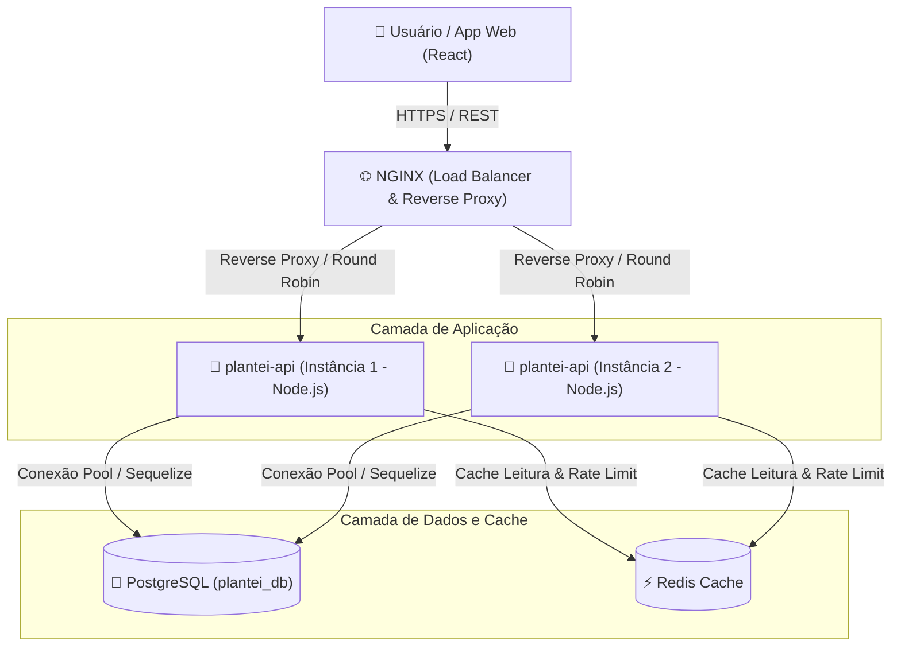
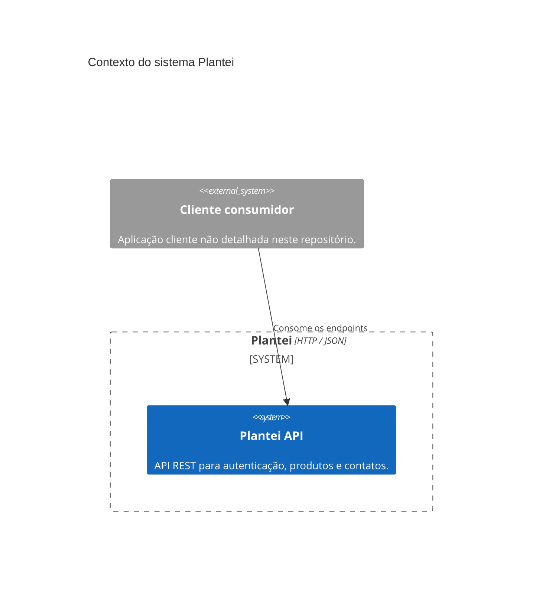
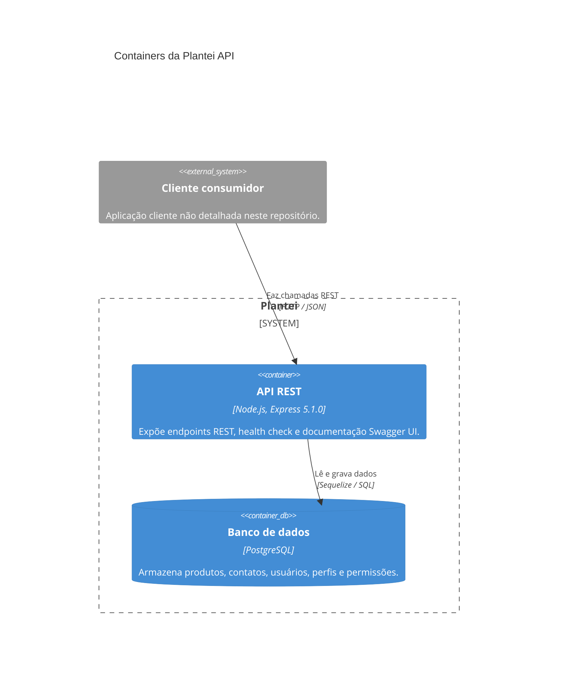
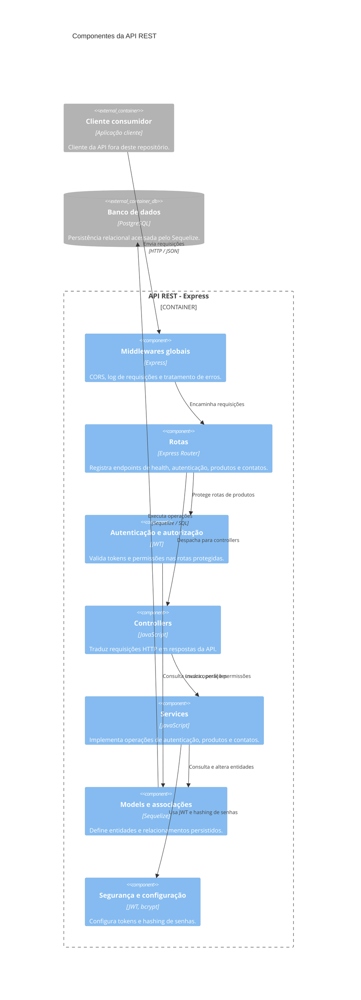

# Diagramas Arquiteturais - C4 Model

Visualização dos diagramas C4 da API Plantei. A fonte Mermaid editável está em [c4-model.mmd](./c4-model.mmd).

## Nível 1 - Contexto

## Nível 2 - Containers

## Nível 3 - Componentes

