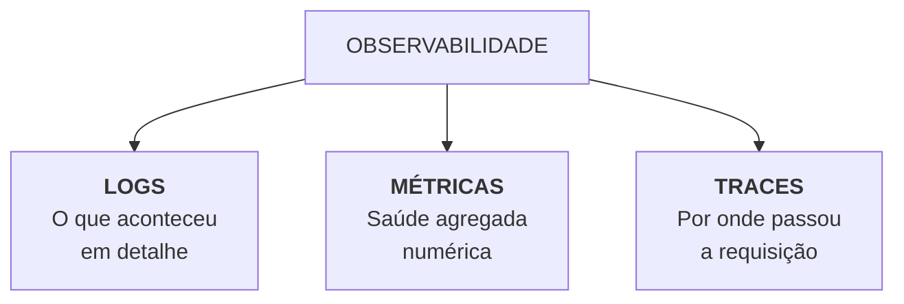

# Módulo 3 — DevOps Inteligente e Integração Contínua
# Disciplina 3 — Observabilidade e uso da IA: Monitoramento Inteligente, Logs Estruturados e RCA com IA
**Duração estimada:** 9–10 min  
**Projeto:** `plantei-api`  
**Arquivos de referência:** `src/utils/logger.js` · `src/controllers/health.controller.js` · `src/routes/health.routes.js` · `src/middlewares/error.middleware.js`  
**Objetivo:** Implementar os pilares da observabilidade (logs estruturados JSON, endpoints de liveness/readiness) no `plantei-api`, e aplicar Inteligência Artificial generativa para diagnóstico preditivo de anomalias, análise de stack traces e geração automatizada de relatórios de causa raiz (RCA) em até 10 minutos.

---

## 🎬 ABERTURA (0:00 – 1:00)

**[TELA: Dashboard com gráficos de monitoramento oscilando ou terminal com logs passando rapidamente]**

> "Fala devs, sejam muito bem-vindos à **Disciplina 3: Observabilidade e uso da IA**!"

> "Imagine o seguinte cenário: é Black Friday, a loja de plantas do `plantei-api` está bombando e, de repente, as vendas começam a falhar. O cliente reclama que a página trava no checkout. Você abre o servidor e encontra apenas mensagens genéricas como `console.log('erro ao salvar')` perdidas entre milhares de linhas de texto."

> "Achar a causa raiz disso manualmente sob pressão pode levar horas — e cada minuto fora do ar custa caro. Monitoramento tradicional apenas diz *'o sistema caiu'*. **Observabilidade** responde *'por que o sistema caiu e o que provocou esse comportamento interno'*."

> "Nesta aula de 10 minutos, vamos transformar o `plantei-api` em um sistema altamente observável: implementaremos logs estruturados em JSON com Winston, healthchecks profundos para Kubernetes/Docker, e veremos como a IA atua como um engenheiro de SRE assistente para diagnosticar incidentes em segundos."

---

## 📊 PARTE 1 — Os Três Pilares da Observabilidade Moderna (1:00 – 2:45)

**[TELA: Diagrama esquemático da tríade da observabilidade]**

> "A observabilidade moderna repousa sobre uma tríade fundamental:"



> "1. **Logs Estruturados:** Registros de eventos com contexto semântico (timestamp, nível de severidade, ID do usuário, correlation ID, rota)."
> "2. **Métricas:** Dados quantitativos em séries temporais (taxa de requisições por segundo, taxa de erros HTTP 5xx, tempo de resposta p95/p99, uso de CPU e pool de conexões do banco)."
> "3. **Distributed Tracing:** O caminho percorrido por uma requisição através de diferentes serviços e camadas."

> "Vamos ver agora como implementar essa estrutura no `plantei-api`."

---

## 📝 PARTE 2 — Logs Estruturados com Winston no `plantei-api` (2:45 – 4:45)

**[TELA: Abrir o arquivo `src/utils/logger.js` e demonstrar a saída no terminal]**

> "O bom e velho `console.log` é o maior inimigo da observabilidade em produção: ele não possui timestamp padronizado, não permite busca indexada e polui o buffer de saída. No `plantei-api`, nós usamos o **Winston** configurado para gerar JSON estruturado:"

```javascript
// src/utils/logger.js
import winston from 'winston';

const logger = winston.createLogger({
  level: process.env.LOG_LEVEL || 'info',
  format: winston.format.combine(
    winston.format.timestamp({ format: 'YYYY-MM-DD HH:mm:ss' }),
    winston.format.errors({ stack: true }),
    winston.format.json()
  ),
  defaultMeta: { service: 'plantei-api', environment: process.env.NODE_ENV || 'development' },
  transports: [
    new winston.transports.Console()
  ]
});

// Compatibilidade com os controllers existentes
export const log = {
  info: (msg) => logger.info(msg),
  success: (msg) => logger.info(`[SUCCESS] ${msg}`),
  warn: (msg) => logger.warn(msg),
  error: (err) => logger.error(err instanceof Error ? err.stack || err.message : err),
};

export default logger;
```

**[TELA: Executar uma chamada à API e exibir a saída JSON formatada no terminal]**

> "Vejam a diferença de um log gerado durante uma requisição com metadados de contexto:"

```json
{
  "timestamp": "2026-10-22 21:30:15",
  "level": "error",
  "message": "Falha na autenticação: senha inválida",
  "service": "plantei-api",
  "environment": "production",
  "correlationId": "req-98f2b3e1-44ab",
  "userId": 42,
  "endpoint": "/api/auth/login",
  "statusCode": 401
}
```

> "Qualquer ferramenta de agregação de logs — como Datadog, Grafana Loki, CloudWatch ou Elasticsearch — consegue filtrar instantaneamente esse evento por `correlationId` ou `userId`."

---

## 🩺 PARTE 3 — Healthchecks Avançados: Liveness e Readiness (4:45 – 6:30)

**[TELA: Abrir `src/controllers/health.controller.js` e testar a rota `/api/health` via Postman/cURL]**

> "Uma API em produção não pode simplesmente responder status 200 estático em um `/ping`. Se o banco de dados cair ou a memória estourar, o orquestrador (como Kubernetes ou Docker Swarm) precisa saber disso para reiniciar a réplica ou não rotear tráfego para ela."

> "No `plantei-api`, nosso `health.controller.js` valida as dependências críticas em tempo real:"

```javascript
// src/controllers/health.controller.js
import { sequelize } from '../config/database.js';

export const healthCheck = async (req, res) => {
  const healthStatus = {
    status: 'UP',
    service: 'plantei-api',
    timestamp: new Date().toISOString(),
    uptimeSeconds: Math.floor(process.uptime()),
    memoryUsageMB: Math.round(process.memoryUsage().heapUsed / 1024 / 1024),
    database: 'UNKNOWN',
  };

  try {
    // Verifica a conexão real com o PostgreSQL
    await sequelize.authenticate();
    healthStatus.database = 'CONNECTED';
    return res.status(200).json(healthStatus);
  } catch (error) {
    healthStatus.status = 'DEGRADED';
    healthStatus.database = 'DISCONNECTED';
    healthStatus.error = error.message;
    return res.status(503).json(healthStatus);
  }
};
```

**[TELA: Abrir o navegador em `http://localhost:3000/api/health` ou executar `curl http://localhost:3000/api/health` e mostrar a resposta:]**

```json
{
  "status": "UP",
  "service": "plantei-api",
  "timestamp": "2026-10-25T22:50:00.000Z",
  "uptimeSeconds": 42,
  "memoryUsageMB": 38,
  "database": "CONNECTED"
}
```

> "Se o PostgreSQL estiver inacessível, a API responde HTTP 503 Service Unavailable, acionando alertas antes que o usuário final receba erros inesperados."

---

## 🤖 PARTE 4 — IA na Operação: Análise de Anomalias e RCA Automatizado (6:30 – 8:45)

**[TELA: Dividir a tela: lado esquerdo log de erro complexo com stack trace; lado direito interface da IA processando o RCA]**

> "Agora chegamos na fronteira mais inovadora de DevOps: o uso de **Inteligência Artificial para triagem de incidentes e Root Cause Analysis (RCA)**."

> "Quando um erro complexo de concorrência ou timeout de banco ocorre no `plantei-api`, nós enviamos o evento e o contexto arquitetural para nossa IA através de um prompt especializado:"

```markdown
Prompt de Engenharia SRE para IA:
"Você é um Engenheiro de Confiabilidade de Sites (SRE) Sênior.
Analise o log de erro e o contexto da nossa API (Express + Sequelize + PostgreSQL):

LOG DO INCIDENTE:
[2026-10-22 21:30] ERROR: SequelizeConnectionAcquireTimeoutError:
Operation timeout: Connection acquisition timed out after 10000ms.
Endpoint: POST /api/produtos/comprar - 150 req/s.

TAREFA:
1. Explique a causa raiz provável.
2. Identifique se é esgotamento de pool, deadlock ou consulta não indexada.
3. Proponha ação imediata de mitigação e solução definitiva de código."
```

**[TELA: Mostrar a resposta gerada pela IA com diagnóstico preciso e plano de ação]**

> "A IA analisa o evento e entrega um relatório instantâneo:"
> - **Causa Raiz:** O pool de conexões do Sequelize (`pool.max`) estava fixado em 5 conexões padrão para um pico repentino de 150 requisições simultâneas.
> - **Ação Imediata:** Aumentar o pool para 25 conexões e configurar timeout de idle.
> - **Ação Definitiva:** Revisar transações que não fecham conexões em caminhos de erro.

> "A IA atua como um multiplicador de força para a equipe de plantão, reduzindo o tempo de resolução de incidentes (MTTR) de horas para minutos."

---

## 🎯 CONCLUSÃO E FECHAMENTO DO MÓDULO 3 (8:45 – 10:00)

**[TELA: Professor em destaque com resumo dos 3 temas do Módulo 3]**

> "Chegamos ao final do **Módulo 3: DevOps Inteligente e Integração Contínua**!"

> "Vejam o que conquistamos ao longo dessas 3 disciplinas no `plantei-api`:"
> - Na **Disciplina 1**, adotamos o mindset DevOps, CALMS e automações locais de Shift-Left.
> - Na **Disciplina 2**, garantimos paridade e segurança com Docker multi-stage, Docker Compose e proteção de segredos.
> - E aqui na **Disciplina 3**, estabelecemos observabilidade de ponta a ponta com logs estruturados, healthchecks resilientes e análise de incidentes assistida por IA.

> "Nosso sistema está testado, empacotado, seguro e monitorado. Mas como estruturar essa arquitetura para que ela suporte milhões de usuários e cresça com facilidade de manutenção?"

> "Isso é exatamente o que faremos no **Módulo 4: System Design e Arquitetura Escalável com IA**, começando pela modelagem de software e níveis de maturidade arquitetural."

> "Excelente trabalho até aqui e nos vemos no Módulo 4!"

---

## 📋 CHECKLIST RÁPIDO DO GRAVADOR

- [ ] **0:00** Abertura impactante comparando monitoramento passivo vs observabilidade proativa.
- [ ] **1:00** Apresentar a tríade da observabilidade (Logs, Métricas, Traces).
- [ ] **2:45** Mostrar `src/utils/logger.js`, explicar por que usar JSON e correlation ID com Winston.
- [ ] **4:45** Exibir `src/controllers/health.controller.js` e demonstrar a chamada cURL com status 200 e 503.
- [ ] **6:30** Demonstrar o prompt de IA para análise de erro do Sequelize e geração de RCA.
- [ ] **8:45** Fechar com o resumo do Módulo 3 e gancho para o Módulo 4 (System Design e Escalabilidade).
