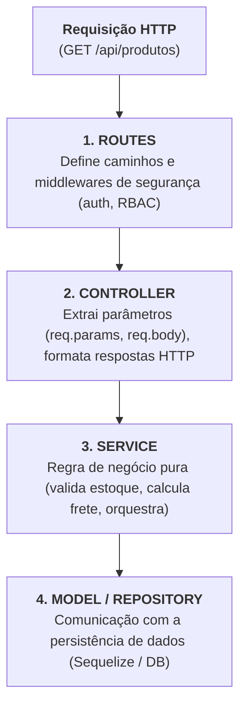
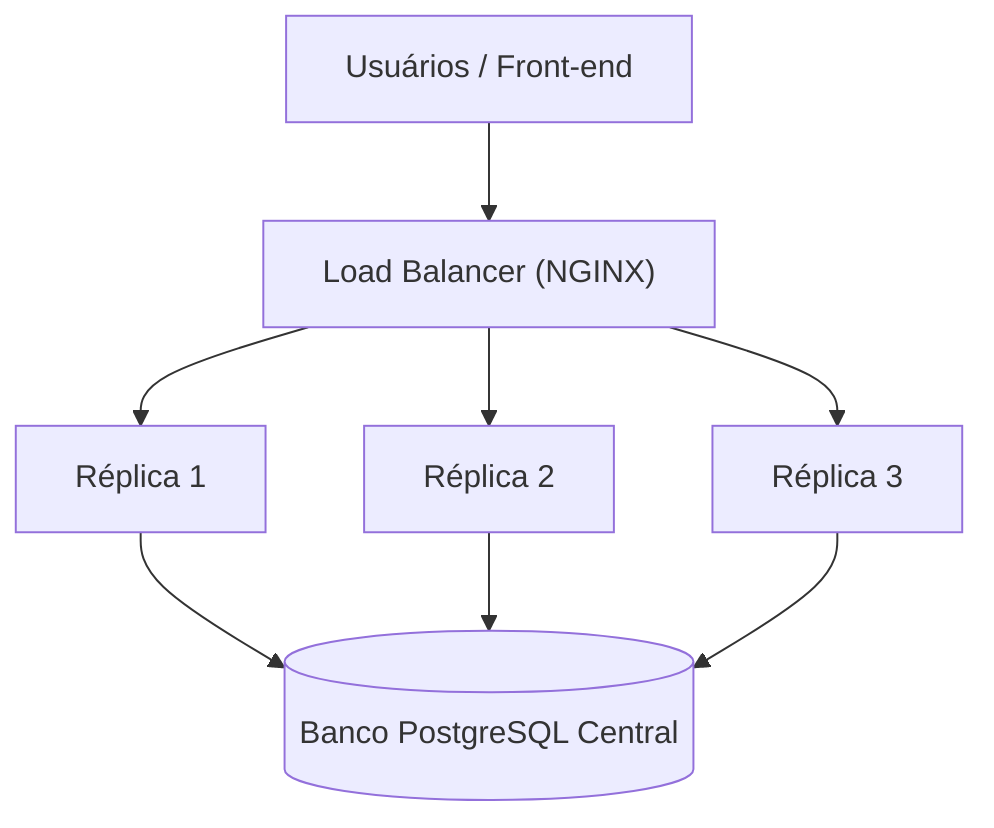

# Módulo 4 — System Design e Arquitetura Escalável com IA
# Disciplina 1 — Modelagem e Maturidade do Software: Do Modelo de Richardson à Arquitetura Escalável
**Duração estimada:** 9–10 min  
**Projeto:** `plantei-api`  
**Arquivos de referência:** `src/models/index.js` · `src/models/Usuario.js` · `src/models/Perfil.js` · `src/models/Permissoes.js` · `src/services/produto.service.js`  
**Objetivo:** Compreender os níveis de maturidade de software e APIs REST (Modelo de Richardson), aplicar princípios de Clean Architecture e separação de camadas no `plantei-api`, e desenhar a modelagem relacional do domínio para suportar escalabilidade horizontal em até 10 minutos.

---

## 🎬 ABERTURA (0:00 – 1:00)

**[TELA: Editor com a árvore de arquivos de `src/models` e `src/services` do `plantei-api`]**

> "Fala devs, sejam muito bem-vindos ao **Módulo 4: System Design e Arquitetura Escalável com IA**!"

> "Qualquer programador consegue criar uma rota que recebe dados e salva no banco. Mas o que acontece quando esse sistema passa de 10 para 500 tabelas? Ou quando o tráfego salta de 10 requisições por segundo para 50 mil requisições por segundo?"

> "Se o software foi desenhado sem princípios arquiteturais sólidos, cada nova alteração se torna um pesadelo: código duplicado, efeitos colaterais imprevisíveis e lentidão generalizada."

> "Nesta aula de 10 minutos, nós vamos aprender como avaliar a maturidade de um sistema usando o Modelo de Richardson, como estruturar o `plantei-api` em camadas estritamente desacopladas e como modelar regras de negócio complexas — como permissões N:N — preparadas para a nuvem."

---

## 🏛️ PARTE 1 — O Modelo de Maturidade de Richardson (1:00 – 3:00)

**[TELA: Diagrama esquemático dos 4 níveis de Leonard Richardson para APIs RESTful]**

> "Para entender o nível de maturidade de uma API, a indústria adota o famoso **Modelo de Maturidade de Richardson**, dividido em 4 níveis:"

```text
┌─────────────────────────────────────────────────────────────┐
│             MODELO DE MATURIDADE DE RICHARDSON              │
├─────────┬───────────────────┬───────────────────────────────┤
│ Nível 3 │ Controles HATEOAS │ Respostas trazem links de     │
│         │ Hipermídia        │ navegação e próximas ações    │
├─────────┼───────────────────┼───────────────────────────────┤
│ Nível 2 │ Verbos HTTP +     │ GET, POST, PUT, DELETE +      │
│         │ Códigos de Status │ Status 200, 201, 204, 404...  │
├─────────┼───────────────────┼───────────────────────────────┤
│ Nível 1 │ Recursos          │ URIs distintas para recursos  │
│         │ Individuais       │ (/api/produtos, /api/usuarios)│
├─────────┼───────────────────┼───────────────────────────────┤
│ Nível 0 │ O Pântano de POX  │ Endpoint único via POST (RPC) │
│         │ (The Swamp of POX)│ Ex: /executar?acao=buscarProd │
└─────────┴───────────────────┴───────────────────────────────┘
```

> "No `plantei-api`, nossa API opera firmemente no **Nível 2**, respeitando a semântica HTTP: `POST /api/produtos` cria um produto e retorna HTTP 201 Created; `GET /api/produtos/:id` busca e retorna 200 ou 404; `DELETE` retorna 204 No Content."

> "E podemos dar os primeiros passos no **Nível 3 (HATEOAS)** ao enriquecer o payload de resposta com links semânticos, permitindo que o cliente descubra automaticamente o link para editar ou remover o recurso sem hardcode no frontend."

---

## 🧱 PARTE 2 — Separação de Camadas e Desacoplamento Limpo (3:00 – 5:15)

**[TELA: Abrir o fluxo no VS Code: `src/routes/produto.routes.js` ➔ `src/controllers/produto.controller.js` ➔ `src/services/produto.service.js` ➔ `src/models/Produto.js`]**

> "Outro pilar de maturidade de software é a estrita **Separação de Responsabilidades (SoC - Separation of Concerns)**. No `plantei-api`, nós nunca colocamos regras de negócio dentro de controllers, nem lógica de requisição HTTP dentro de models."



> "Vejam a elegância desse design: se amanhã trocarmos o Express pelo Fastify ou pelo NestJS, nossos **Services e Regras de Negócio não sofrem nenhuma alteração**. E para testar, podemos mockar o Service sem depender de servidor HTTP."

---

## 🗄️ PARTE 3 — Modelagem Relacional de Domínios Complexos (5:15 – 7:30)

**[TELA: Abrir `src/models/index.js` e diagramar o relacionamento entre Usuários, Perfis e Permissões]**

> "Vamos abrir o `src/models/index.js`. O `plantei-api` possui um sistema corporativo de controle de acesso baseado em papéis (RBAC - Role-Based Access Control)."

> "Observem como modelamos a relação Many-to-Many entre Perfis e Permissões:"

```javascript
// src/models/index.js
import Usuario from './Usuario.js';
import Perfil from './Perfil.js';
import Permissoes from './Permissoes.js';

// Um Usuário pertence a um Perfil (1:N)
Usuario.belongsTo(Perfil, { foreignKey: 'perfil_id', as: 'perfil' });
Perfil.hasMany(Usuario, { foreignKey: 'perfil_id', as: 'usuarios' });

// Um Perfil possui N Permissões e uma Permissão pode estar em N Perfis (N:N)
Perfil.belongsToMany(Permissoes, {
  through: 'PerfilPermissoes',
  foreignKey: 'perfil_id',
  otherKey: 'permissao_id',
  as: 'permissoes'
});
Permissoes.belongsToMany(Perfil, {
  through: 'PerfilPermissoes',
  foreignKey: 'permissao_id',
  otherKey: 'perfil_id',
  as: 'perfis'
});
```

> "Esse modelo garante que adicionar novas permissões operacionais — como 'CADASTRAR_PRODUTO' ou 'APROVAR_PEDIDO' — não exige alterar o código do usuário: basta associar a permissão ao perfil através da tabela associativa `PerfilPermissoes`."

---

## ☁️ PARTE 4 — Princípios de Escalabilidade Horizontal e Stateless (7:30 – 8:50)

**[TELA: Diagrama de múltiplas instâncias da API atrás de um Load Balancer acessando o mesmo banco de dados]**

> "Para que um sistema escale horizontalmente (isto é, adicionando mais réplicas de containers em vez de apenas comprar máquinas mais caras), ele **precisa ser estritamente Stateless (sem estado)**."



> "No `plantei-api`, nós não guardamos sessões em memória local (`express-session` em memória RAM é uma armadilha que impede ter 2 réplicas!)."
> "Nós usamos **JSON Web Tokens (JWT) criptograficamente assinados**: a requisição carrega seu próprio estado e credenciais, permitindo que o Load Balancer direcione qualquer requisição para qualquer réplica com total consistência."

---

## 🎯 CONCLUSÃO E PRÓXIMOS PASSOS (8:50 – 10:00)

**[TELA: Professor em destaque com resumo dos 4 conceitos da aula]**

> "Hoje aprendemos como elevar o nível arquitetural do `plantei-api`: aplicamos o Modelo de Richardson Nível 2 e 3, desacoplamos as camadas em rotas, controllers e services, modelamos relacionamentos relacionais N:N de alta flexibilidade e projetamos a aplicação para ser 100% Stateless."

> "Mas uma arquitetura excelente precisa ser comunicada com clareza para outros desenvolvedores, clientes e parceiros."

> "Na **Disciplina 2**, vamos ver como acelerar a documentação técnica com IA: gerando documentação interativa Swagger/OpenAPI 3.0, diagramas arquiteturais C4 Model e Registros de Decisão de Arquitetura (ADRs) sem esforço manual."

> "Até a próxima aula!"

---

## 📋 CHECKLIST RÁPIDO DO GRAVADOR

- [ ] **0:00** Abertura abordando o desafio de escala e código desorganizado.
- [ ] **1:00** Apresentar a tabela dos Níveis de Richardson (0 a 3) e posicionar a API.
- [ ] **3:00** Navegar no código mostrando a separação Router ➔ Controller ➔ Service ➔ Model.
- [ ] **5:15** Exibir `src/models/index.js` com o relacionamento N:N entre Perfil e Permissoes.
- [ ] **7:30** Diagramar o conceito de aplicação Stateless com JWT atrás de um Load Balancer.
- [ ] **8:50** Concluir e fazer o gancho para a Disciplina 2 (Documentação com IA e Swagger).
