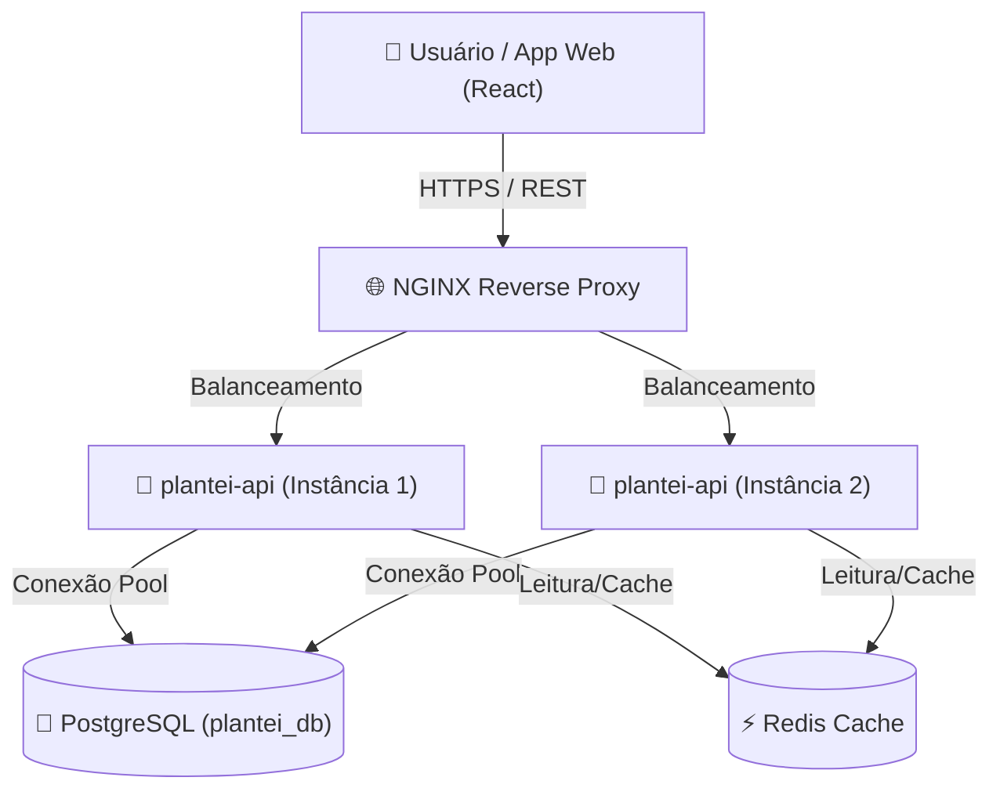

# Módulo 4 — System Design e Arquitetura Escalável com IA
# Disciplina 2 — Acelerando a Documentação com IA: OpenAPI/Swagger, Diagramas C4 e ADRs Vivos
**Duração estimada:** 9–10 min  
**Projeto:** `plantei-api`  
**Arquivos de referência:** `package.json` · `src/app.js` · `docs/swagger.js` · `docs/diagrams/c4-model.mmd` · `docs/adr/001-adopcao-postgresql-e-jwt.md`  
**Objetivo:** Instalar e configurar a documentação interativa Swagger (OpenAPI 3.0) do zero no `plantei-api`, utilizar IA para extrair schemas e endpoints a partir dos Models/Controllers, e versionar diagramas C4 Model e ADRs no repositório.

---

## 🎬 ABERTURA & CONTEXTO (0:00 – 1:00)

**[TELA: Editor aberto no terminal do `plantei-api` e uma aba rápida mostrando uma interface do Swagger UI interativa]**

> "Fala devs, sejam muito bem-vindos à **Disciplina 2: Acelerando a Documentação com IA**!"

> "Vamos ser francos: documentação feita à mão em Word, Confluence ou Notion nasce desatualizada e morre esquecida. Mas um sistema sem documentação trava o onboarding de novos devs e transforma qualquer integração de frontend ou parceiro em um suporte interminável."

> "Hoje vamos resolver isso de forma definitiva: vamos partir da **instalação das dependências e configuração no código**, usar a IA para extrair a especificação OpenAPI 3.0 do nosso `plantei-api` em segundos, e fechar com diagramas C4 vivos em Mermaid e registros de decisão arquitetural (ADRs)."

---

## 🛠️ PASSO 1 — Instalação e Estrutura de Documentação (1:00 – 2:30)

**[TELA: Terminal do VS Code aberto na raiz de `plantei-api` executando os comandos]**

> "O primeiro passo é instalar o middleware responsável por renderizar a interface gráfica do Swagger dentro do Express."

### 1.1 Instalação do Pacote
```bash
npm install swagger-ui-express
```

---

### 1.2 Criação da Estrutura de Diretórios
> "Para manter o projeto profissional e organizado no padrão *Docs as Code*, criamos uma pasta dedicada `docs/` para abrigar a documentação da API, diagramas e registros de decisão:"

```bash
mkdir docs
mkdir docs/diagrams
mkdir docs/adr
```

---

## 🤖 PASSO 2 — Extraindo Schemas e Endpoints com IA (2:30 – 4:45)

**[TELA: Lado esquerdo com `src/models/Produto.js` e `src/controllers/produto.controller.js`; lado direito no Chat de IA colando o prompt]**

> "Agora vem o pulo do gato: em vez de digitar 300 linhas de YAML/JSON na mão, alimentamos a IA com os nossos arquivos reais de modelo e rotas para ela gerar a especificação OpenAPI 3.0 exata."

### Prompt de Engenharia de Contexto para a IA:
```markdown
Você é um Arquiteto de Software especialista em OpenAPI 3.0 e Node.js.
Analise o Model Produto (Sequelize) e o Controller de produtos anexados (operações GET, POST, PUT, DELETE).

Gere um arquivo JavaScript (`docs/swagger.js`) exportando o objeto de especificação OpenAPI 3.0 completo com:
1. Metadados da API (title: "Plantei API", version: "1.0.0", description).
2. Esquema de autenticação Bearer JWT no componente `securitySchemes`.
3. Schemas completos com tipos, validações e exemplos reais de plantas/produtos.
4. Definição completa das rotas `/api/produtos` e `/api/produtos/{id}` com códigos 200, 201, 400, 401, 404 e 500.
```

### 2.1 Criando o arquivo `docs/swagger.js`
> "A IA nos retorna a especificação pronta no formato ES Module, evitando problemas com imports de JSON no Node moderno:"

```javascript
// docs/swagger.js
export const swaggerSpec = {
  openapi: '3.0.0',
  info: {
    title: 'Plantei API',
    version: '1.0.0',
    description: 'Documentação viva interativa das rotas e esquemas da Plantei API.'
  },
  servers: [
    { url: '/', description: 'Servidor Atual (Automático)' },
    { url: 'http://localhost:5000', description: 'Ambiente Local (Porta 5000)' }
  ],
  components: {
    securitySchemes: {
      bearerAuth: {
        type: 'http',
        scheme: 'bearer',
        bearerFormat: 'JWT'
      }
    },
    schemas: {
      Produto: {
        type: 'object',
        required: ['nome', 'preco', 'estoque'],
        properties: {
          id: { type: 'integer', example: 1 },
          nome: { type: 'string', example: 'Monstera Deliciosa (Costela-de-Adão)' },
          descricao: { type: 'string', example: 'Planta de folhagem exuberante e meia-sombra' },
          preco: { type: 'number', example: 89.90 },
          estoque: { type: 'integer', example: 15 },
          image_url: { type: 'string', example: 'https://images.unsplash.com/photo-1614594975525-e45190c55d0b' }
        }
      }
    }
  },
  paths: {
    '/api/produtos': {
      get: {
        summary: 'Listar produtos cadastrados',
        tags: ['Produtos'],
        security: [{ bearerAuth: [] }],
        responses: {
          200: { description: 'Lista de produtos retornada com sucesso' }
        }
      },
      post: {
        summary: 'Cadastrar novo produto',
        tags: ['Produtos'],
        security: [{ bearerAuth: [] }],
        responses: {
          201: { description: 'Produto criado com sucesso' },
          400: { description: 'Dados de validação incorretos' }
        }
      }
    }
  }
};
```

---

## 🔌 PASSO 3 — Conectando o Swagger no Express (`src/app.js`) (4:45 – 6:15)

**[TELA: Abrir `src/app.js`, importar os módulos e adicionar a rota de documentação]**

> "Com o spec gerado, basta importar o `swagger-ui-express` e o nosso `swaggerSpec` dentro do `src/app.js` e expor o endpoint `/api-docs`:"

```javascript
// src/app.js
import express from 'express';
import cors from './config/cors.js';
import routes from './routes/index.js';
import healthRoutes from './routes/health.routes.js';
import errorMiddleware from './middlewares/error.middleware.js';
import requestLoggerMiddleware from './middlewares/request-logger.middleware.js';

// 1. Importar o Swagger UI e a especificação gerada
import swaggerUi from 'swagger-ui-express';
import { swaggerSpec } from '../docs/swagger.js';

const app = express();

app.use(cors);
app.use(requestLoggerMiddleware);
app.use(express.json());

// 2. Rota interativa de documentação Swagger
app.use('/api-docs', swaggerUi.serve, swaggerUi.setup(swaggerSpec));

// Rotas existentes da aplicação
app.use('/health', healthRoutes);
app.use('/api', routes);

app.use(errorMiddleware);

export default app;
```

### 3.1 Testando a Documentação Viva
> "Subimos a API com `npm start` e acessamos no navegador `http://localhost:5000/api-docs`."

**[TELA: Navegador em `http://localhost:5000/api-docs`, clicando em `GET /health` ou `GET /api/produtos`, depois no botão 'Try it out' e 'Execute', mostrando a resposta em tempo real sem erros de CORS]**

---

## 📐 PASSO 4 — Diagramas Arquiteturais com C4 Model e Mermaid (6:15 – 7:45)

**[TELA: Abrir o arquivo `docs/diagrams/c4-model.mmd` e visualizar a renderização em tempo real]**

> "A documentação de endpoints mostra como conversar com a API, mas para entender como os componentes se conectam, precisamos de documentação arquitetural. Usamos o **C4 Model** com sintaxe **Mermaid**, que renderiza nativamente no GitHub e em editores Markdown."

### Arquivo: `docs/diagrams/c4-model.mmd`


> "Como o diagrama é código puro versionado no Git, qualquer mudança de infraestrutura é revisada via Pull Request."

---

## 📝 PASSO 5 — Registros de Decisão de Arquitetura (ADRs) com IA (7:45 – 9:00)

**[TELA: Abrir `docs/adr/001-adopcao-postgresql-e-jwt.md`]**

> "E para registrar o *'porquê'* das escolhas técnicas antes que o contexto se perca, criamos **ADRs (Architecture Decision Records)** usando a IA para formatar a justificativa técnica."

### Arquivo: `docs/adr/001-adopcao-postgresql-e-jwt.md`
```markdown
# ADR 001: Adoção de PostgreSQL e Autenticação JWT no Plantei API
## Status: Aceito (Accepted)
## Data: 2026-10-29

## Contexto:
O sistema necessita de integridade referencial para pedidos, estoque e usuários, além de suporte a alta concorrência com réplicas sem sessão em memória.

## Decisão:
1. Utilizar PostgreSQL com Sequelize ORM para consistência transacional ACID.
2. Utilizar autenticação stateless via tokens JWT para facilitar o escalonamento horizontal.

## Consequências:
- **Positivas:** Fácil escalabilidade das instâncias de API e integridade garantida no banco.
- **Negativas:** Exige migrações controladas de banco e revogação de tokens via lista de bloqueio/Redis.
```

---

## 🎯 CONCLUSÃO E PRÓXIMA AULA (9:00 – 10:00)

**[TELA: Professor com resumo dos passos executados]**

> "Em menos de 10 minutos saímos de uma API sem documentação para um ecossistema com Swagger interativo em `/api-docs`, diagramas C4 vivos e decisões arquiteturais registradas com o apoio da IA."

> "Agora que nossa arquitetura está documentada e compreensível, o próximo desafio é desempenho: **o que acontece quando milhares de pessoas tentam comprar ao mesmo tempo na Plantei?**"

> "Na nossa próxima aula — **Otimização e Performance** —, vamos caçar gargalos de queries no Postgres, aplicar cache inteligente com Redis e estressar nossa API com testes de carga no k6."

> "Bora codar e até a próxima!"

---

## 📋 CHECKLIST RÁPIDO DO GRAVADOR

- [ ] **1:00** Rodar `npm install swagger-ui-express` no terminal.
- [ ] **2:00** Criar a árvore de pastas `docs/`, `docs/diagrams/` e `docs/adr/`.
- [ ] **2:30** Demonstrar o prompt com IA analisando `Produto.js` e salvando `docs/swagger.js`.
- [ ] **4:45** Inserir os imports e o middleware `app.use('/api-docs', ...)` no `src/app.js`.
- [ ] **5:30** Rodar `npm start` e testar a rota no navegador `http://localhost:5000/api-docs`.
- [ ] **6:15** Exibir o diagrama C4 Model em Mermaid no editor.
- [ ] **7:45** Mostrar o arquivo ADR 001 estruturado.
- [ ] **9:00** Finalizar com chamada para a aula de Otimização e Cache com Redis.
