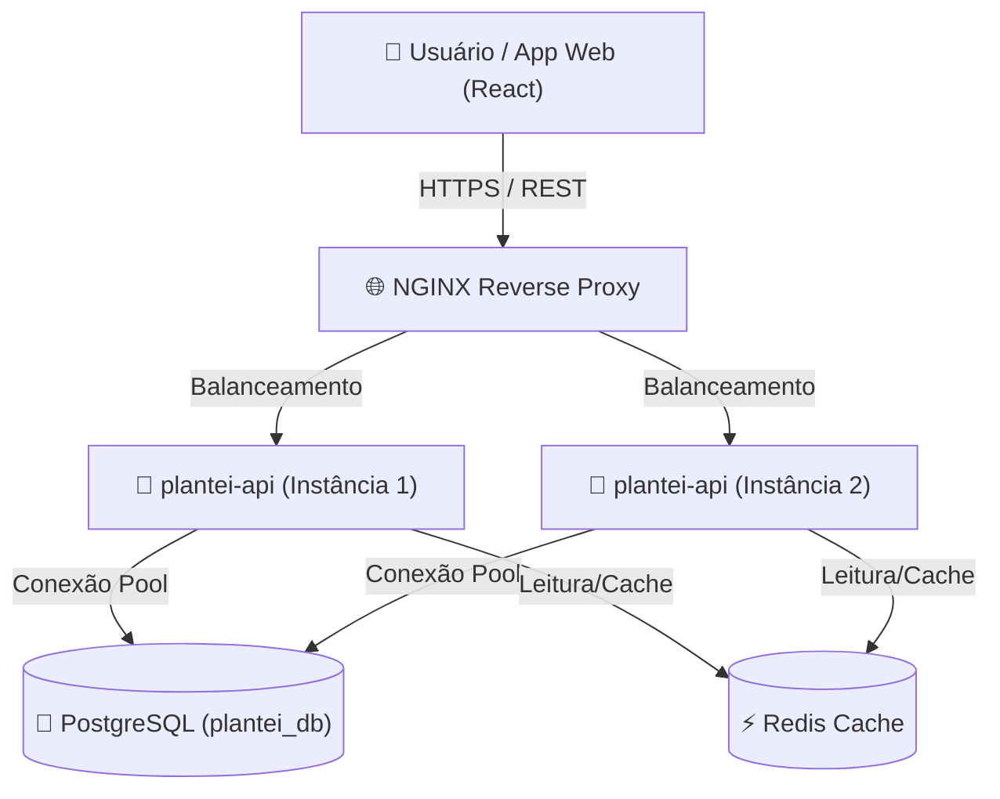

# Módulo 4 — System Design e Arquitetura Escalável com IA
# Disciplina 2 — Acelerando a Documentação com IA: OpenAPI/Swagger, Diagramas C4 e ADRs Vivos
**Duração estimada:** 9–10 min  
**Projeto:** `plantei-api`  
**Arquivos de referência:** `package.json` · `src/app.js` · `src/config/cors.js` · `src/server.js` · `docs/swagger.js` · `docs/diagrams/c4-model.mmd` · `docs/adr/001-adopcao-postgresql-e-jwt.md` · `src/__tests__/integration/swagger.routes.test.js`  
**Objetivo:** Instalar e configurar a documentação interativa Swagger (OpenAPI 3.0) do zero no `plantei-api`, utilizar IA para extrair schemas e endpoints a partir dos Models/Controllers, configurar o CORS para permitir requisições diretas pelo navegador no Swagger UI, garantir alinhamento entre schema e banco de dados, e versionar diagramas C4 Model e ADRs no repositório.

---

## 🎬 ABERTURA & CONTEXTO (0:00 – 1:00)

**[TELA: Editor aberto no terminal do `plantei-api` e uma aba rápida mostrando uma interface do Swagger UI interativa]**

> "Fala devs, sejam muito bem-vindos à **Disciplina 2: Acelerando a Documentação com IA**!"

> "Vamos ser francos: documentação feita à mão em Word, Confluence ou Notion nasce desatualizada e morre esquecida. Mas um sistema sem documentação trava o onboarding de novos devs e transforma qualquer integração de frontend ou parceiro em um suporte interminável."

> "Hoje vamos resolver isso de forma definitiva: vamos partir da **instalação das dependências e configuração no código**, usar a IA para extrair a especificação OpenAPI 3.0 do nosso `plantei-api` em segundos — com schemas reais de produtos e autenticação —, testar o fluxo ponta a ponta com token JWT direto no Swagger UI, e fechar com diagramas C4 vivos em Mermaid e registros de decisão arquitetural (ADRs)."

---

## 🛠️ PASSO 1 — Instalação e Estrutura de Documentação (1:00 – 2:15)

**[TELA: Terminal do VS Code aberto na raiz de `plantei-api` executando os comandos]**

> "O primeiro passo é instalar o middleware responsável por renderizar a interface gráfica do Swagger dentro do Express."

### 1.1 Instalação do Pacote
```bash
npm install swagger-ui-express
```

---

### 1.2 Criação da Estrutura de Diretórios
> "Para manter o projeto profissional e organizado no padrão *Docs as Code*, criamos uma pasta dedicada `docs/` para abrigar a documentação da API, diagramas e registros de decisão:"

```bash
mkdir docs
mkdir docs/diagrams
mkdir docs/adr
```

---

## 🤖 PASSO 2 — Extraindo Schemas e Endpoints com IA (2:15 – 4:30)

**[TELA: Lado esquerdo com `src/models/Produto.js`, `src/models/Usuario.js` e controllers; lado direito no Chat de IA colando o prompt]**

> "Agora vem o pulo do gato: em vez de digitar 400 linhas de YAML/JSON na mão, alimentamos a IA com os nossos arquivos reais de modelo e rotas para ela gerar a especificação OpenAPI 3.0 exata."

### Prompt de Engenharia de Contexto para a IA:
```markdown
Você é um Arquiteto de Software especialista em OpenAPI 3.0 e Node.js.
Analise os Models Sequelize (Produto, Usuario, Perfil) e os Controllers anexados.

Gere um arquivo JavaScript (`docs/swagger.js`) exportando o objeto de especificação OpenAPI 3.0 completo com:
1. Metadados da API (title: "Plantei API", version: "1.0.0", description).
2. Esquema de autenticação Bearer JWT no componente `securitySchemes`.
3. Schemas completos com tipos, validações e exemplos reais:
   - Produto e ProdutoInput (nome, descricao, preco, estoque, image_url)
   - LoginInput (email, senha)
   - RegisterInput alinhado ao Model Usuario (nome, email, senha, cpf com 11 dígitos, id_perfil)
4. Definição completa das rotas:
   - `/health` e `/api/health`
   - `/api/auth/register`, `/api/auth/login` e `/api/auth/logout`
   - `/api/produtos` e `/api/produtos/{id}` protegidas por JWT
```

### 2.1 Criando o arquivo `docs/swagger.js`
> "A IA nos retorna a especificação pronta no formato ES Module. Reparem no cuidado com o schema `RegisterInput`: o modelo `Usuario` exige `cpf` de 11 dígitos e chave estrangeira `id_perfil`. Documentar com precisão evita que o consumidor da API tome erros de validação:"

```javascript
// docs/swagger.js
export const swaggerSpec = {
  openapi: '3.0.0',
  info: {
    title: 'Plantei API',
    version: '1.0.0',
    description: 'Documentação viva interativa das rotas e esquemas da Plantei API.'
  },
  servers: [
    { url: '/', description: 'Servidor Atual (Automático)' },
    { url: 'http://localhost:5000', description: 'Ambiente Local (Porta 5000)' }
  ],
  components: {
    securitySchemes: {
      bearerAuth: {
        type: 'http',
        scheme: 'bearer',
        bearerFormat: 'JWT',
        description: 'Insira o token JWT gerado no endpoint de login'
      }
    },
    schemas: {
      RegisterInput: {
        type: 'object',
        required: ['nome', 'email', 'senha', 'cpf'],
        properties: {
          nome: { type: 'string', example: 'Maria Silva' },
          email: { type: 'string', format: 'email', example: 'maria@plantei.com' },
          cpf: { type: 'string', minLength: 11, maxLength: 11, example: '12345678901' },
          senha: { type: 'string', format: 'password', example: 'SenhaSegura@123' },
          id_perfil: { type: 'integer', example: 2, description: '1: Admin, 2: Usuário, 3: Fornecedor' }
        }
      },
      LoginInput: {
        type: 'object',
        required: ['email', 'senha'],
        properties: {
          email: { type: 'string', format: 'email', example: 'maria@plantei.com' },
          senha: { type: 'string', format: 'password', example: 'SenhaSegura@123' }
        }
      },
      Produto: {
        type: 'object',
        required: ['nome', 'preco', 'estoque'],
        properties: {
          id: { type: 'integer', example: 1 },
          nome: { type: 'string', example: 'Monstera Deliciosa (Costela-de-Adão)' },
          descricao: { type: 'string', example: 'Planta de folhagem exuberante e meia-sombra' },
          preco: { type: 'number', example: 89.90 },
          estoque: { type: 'integer', example: 15 },
          image_url: { type: 'string', example: 'https://images.unsplash.com/photo-1614594975525-e45190c55d0b' }
        }
      }
    }
  },
  paths: {
    // Endpoints de autenticação, health check e produtos...
  }
};
```

### 2.2 Ajustes de Robustez no Código (Service e Controller)
> "Para garantir que a integração seja tolerante e amigável:
> 1. No `src/services/auth.service.js`, aceitamos tanto `id_perfil` quanto `perfilId` (com fallback para o perfil `2` - Usuário).
> 2. No `src/controllers/auth.controller.js`, extraímos `err.errors` para retornar mensagens claras caso um campo viole a unicidade (como CPF ou e-mail já existente)."

---

## 🔌 PASSO 3 — Conectando o Swagger e Inicializando a Aplicação (4:30 – 6:30)

### 3.1 Conectando o Swagger UI em `src/app.js`
**[TELA: Abrir `src/app.js`, importar os módulos e adicionar a rota de documentação]**

> "Com o spec gerado, importamos o `swagger-ui-express` e o `swaggerSpec` dentro do `src/app.js` e expomos o endpoint `/api-docs`:"

```javascript
// src/app.js
import express from 'express';
import cors from './config/cors.js';
import routes from './routes/index.js';
import healthRoutes from './routes/health.routes.js';
import errorMiddleware from './middlewares/error.middleware.js';
import requestLoggerMiddleware from './middlewares/request-logger.middleware.js';

// 1. Importar o Swagger UI e a especificação gerada
import swaggerUi from 'swagger-ui-express';
import { swaggerSpec } from '../docs/swagger.js';

const app = express();

app.use(cors);
app.use(requestLoggerMiddleware);
app.use(express.json());

// 2. Rota interativa de documentação Swagger
app.use('/api-docs', swaggerUi.serve, swaggerUi.setup(swaggerSpec));

// Rotas da aplicação
app.use('/health', healthRoutes);
app.use('/api', routes);

app.use(errorMiddleware);

export default app;
```

### 3.2 Configuração Crítica de CORS para o Swagger UI (`src/config/cors.js`)
**[TELA: Abrir `src/config/cors.js` e destacar as origens permitidas e headers]**

> "⚠️ **Atenção total aqui:** Um dos erros mais comuns ao colocar Swagger em produção ou desenvolvimento é a política de CORS. O Swagger UI roda no navegador (em `http://localhost:5000/api-docs` ou `http://127.0.0.1:5000`). Quando você clica em 'Execute', o navegador dispara uma requisição `fetch` assíncrona para a própria API."
>
> "Se a origem local da porta 5000 não estiver explicitamente permitida, ou se o header `Authorization` não estiver liberado, o navegador bloqueia a requisição na hora com `CORS Error`! Veja como configuramos o `src/config/cors.js` com precisão:"

```javascript
// src/config/cors.js
import cors from 'cors';

const PORT = process.env.PORT || 5000;
const HOST = process.env.HOST || 'localhost';

const allowedOrigins = [
  'http://localhost:5173',   // Frontend Vite
  'http://127.0.0.1:5173',
  'http://localhost:3000',   // Frontend React (CRA)
  'http://127.0.0.1:3000',
  'http://localhost:5000',   // 👈 Swagger UI local
  'http://127.0.0.1:5000',   // 👈 Swagger UI via loopback
  `http://${HOST}:${PORT}`,
  `http://localhost:${PORT}`,
];

const corsOptions = {
  origin: (origin, callback) => {
    // Permite chamadas sem origin (Postman, curl, backend-to-backend)
    if (!origin) return callback(null, true);

    if (
      allowedOrigins.includes(origin) ||
      origin.endsWith(`:${PORT}`) // Suporte flexível para porta dinâmica
    ) {
      return callback(null, true);
    }

    return callback(new Error('Not allowed by CORS'));
  },
  methods: ['GET', 'POST', 'PUT', 'PATCH', 'DELETE'],
  allowedHeaders: [
    'Content-Type',
    'Authorization', // 👈 FUNDAMENTAL para enviar o token JWT no Swagger!
  ],
  credentials: true,
};

export default cors(corsOptions);
```

> "E para garantir que essa configuração nunca quebre em regressões, criamos testes de integração automatizados em `src/__tests__/integration/swagger.routes.test.js`, validando que requisições com `Origin: http://localhost:5000` e `http://127.0.0.1:5000` passem sem nenhum bloqueio de CORS!"

---

### 3.3 Inicialização Estável do Banco em `src/server.js`
> "💡 **Dica de Ouro de Arquitetura:** No `src/server.js`, utilizamos `await sequelize.sync();` sem a flag `{ alter: true }`. Em ambientes com recarregamento contínuo (`nodemon`), o `{ alter: true }` com PostgreSQL tenta recriar índices únicos repetidamente, poluindo o catálogo do banco. O `sync()` limpo garante inicialização rápida e tabelas sincronizadas."

```javascript
// src/server.js
await sequelize.authenticate();
console.log('🎉 Banco conectado');

await sequelize.sync(); // Inicialização segura
console.log('📦 Modelos sincronizados');
```

---

## 🧪 PASSO 4 — Testando o Fluxo Completo no Swagger UI (6:30 – 7:45)

**[TELA: Navegador aberto em `http://localhost:5000/api-docs` com a interface Swagger em tema escuro]**

> "Com a aplicação rodando via `npm start`, acessamos `http://localhost:5000/api-docs`. Vamos testar um fluxo de ponta a ponta sem precisar de Postman ou Insomnia!"

### 4.1 Cadastro de Usuário (`POST /api/auth/register`)
- Clicar em **POST /api/auth/register** > **Try it out**.
- Preencher com dados únicos (ex: CPF de 11 dígitos e e-mail único).
- Clicar em **Execute** e verificar o status **201 Created** com o ID do usuário criado.

### 4.2 Login e Obtenção do Token JWT (`POST /api/auth/login`)
- Clicar em **POST /api/auth/login** > **Try it out**.
- Informar o e-mail e senha cadastrados > **Execute**.
- Obter a resposta **200 OK** com o token JWT gerado e copiar o hash do token.

### 4.3 Autorização Global no Swagger (Botão Authorize 🔒)
- No topo da página do Swagger UI, clicar no botão **Authorize** (ícone do cadeado).
- No campo `bearerAuth`, colar o token JWT e clicar em **Authorize** > **Close**.
- Pronto! Todas as requisições protegidas agora enviarão o header `Authorization: Bearer <token>` automaticamente.

### 4.4 Consumindo Rotas Protegidas (`GET /api/produtos`)
- Abrir **GET /api/produtos** > **Try it out** > **Execute**.
- Visualizar o status **200 OK** com a listagem de produtos retornada diretamente pelo PostgreSQL.

---

## 📐 PASSO 5 — Diagramas Arquiteturais com C4 Model e Mermaid (7:45 – 8:30)

**[TELA: Abrir o arquivo `docs/diagrams/c4-model.mmd` e visualizar a renderização em tempo real]**

> "A documentação de endpoints mostra como conversar com a API, mas para entender como os componentes se conectam, precisamos de documentação arquitetural. Usamos o **C4 Model** com sintaxe **Mermaid**, que renderiza nativamente no GitHub e em editores Markdown."

### Arquivo: `docs/diagrams/c4-model.mmd`


> "Como o diagrama é código puro versionado no Git, qualquer mudança de infraestrutura é revisada via Pull Request."

---

## 📝 PASSO 6 — Registros de Decisão de Arquitetura (ADRs) com IA (8:30 – 9:15)

**[TELA: Abrir `docs/adr/001-adopcao-postgresql-e-jwt.md`]**

> "E para registrar o *'porquê'* das escolhas técnicas antes que o contexto se perca, criamos **ADRs (Architecture Decision Records)** usando a IA para formatar a justificativa técnica."

### Arquivo: `docs/adr/001-adopcao-postgresql-e-jwt.md`
```markdown
# ADR 001: Adoção de PostgreSQL e Autenticação JWT no Plantei API
## Status: Aceito (Accepted)
## Data: 2026-10-29

## Contexto:
O sistema necessita de integridade referencial para pedidos, estoque e usuários, além de suporte a alta concorrência com réplicas sem sessão em memória.

## Decisão:
1. Utilizar PostgreSQL com Sequelize ORM para consistência transacional ACID.
2. Utilizar autenticação stateless via tokens JWT para facilitar o escalonamento horizontal.

## Consequências:
- **Positivas:** Fácil escalabilidade das instâncias de API e integridade garantida no banco.
- **Negativas:** Exige migrações controladas de banco e revogação de tokens via lista de bloqueio/Redis.
```

---

## 🎯 CONCLUSÃO E PRÓXIMA AULA (9:15 – 10:00)

**[TELA: Professor com resumo dos passos executados]**

> "Em menos de 10 minutos saímos de uma API sem documentação para um ecossistema com Swagger interativo em `/api-docs` totalmente funcional com JWT, diagramas C4 vivos e decisões arquiteturais registradas com o apoio da IA."

> "Agora que nossa arquitetura está documentada e compreensível, o próximo desafio é desempenho: **o que acontece quando milhares de pessoas tentam comprar ao mesmo tempo na Plantei?**"

> "Na nossa próxima aula — **Otimização e Performance** —, vamos caçar gargalos de queries no Postgres, aplicar cache inteligente com Redis e estressar nossa API com testes de carga no k6."

> "Bora codar e até a próxima!"

---

## 📋 CHECKLIST RÁPIDO DO GRAVADOR

- [ ] **1:00** Rodar `npm install swagger-ui-express` no terminal.
- [ ] **1:45** Criar a árvore de pastas `docs/`, `docs/diagrams/` e `docs/adr/`.
- [ ] **2:15** Demonstrar o prompt com IA analisando `Produto.js` e `Usuario.js`, e salvando `docs/swagger.js`.
- [ ] **3:45** Destacar o alinhamento de `cpf` (11 dígitos) e `id_perfil` em `RegisterInput`, e a flexibilidade em `auth.service.js`.
- [ ] **4:30** Inserir os imports e o middleware `app.use('/api-docs', ...)` no `src/app.js`.
- [ ] **5:00** Explicar a configuração de CORS em `src/config/cors.js` (whitelist de `localhost:5000`, `127.0.0.1:5000` e header `Authorization`).
- [ ] **5:45** Ressaltar o uso de `sequelize.sync()` limpo no `src/server.js` (sem `{ alter: true }`).
- [ ] **6:30** Abrir `http://localhost:5000/api-docs` e demonstrar o fluxo completo:
  - [ ] Cadastrar usuário em `POST /api/auth/register` (201 Created).
  - [ ] Efetuar login em `POST /api/auth/login` e copiar o token JWT (200 OK).
  - [ ] Clicar no botão **Authorize 🔒** no topo e aplicar o token.
  - [ ] Executar rota protegida `GET /api/produtos` autenticado (200 OK).
- [ ] **7:45** Exibir o diagrama C4 Model em Mermaid no editor.
- [ ] **8:30** Mostrar o arquivo ADR 001 estruturado.
- [ ] **9:15** Finalizar com chamada para a aula de Otimização e Cache com Redis.
