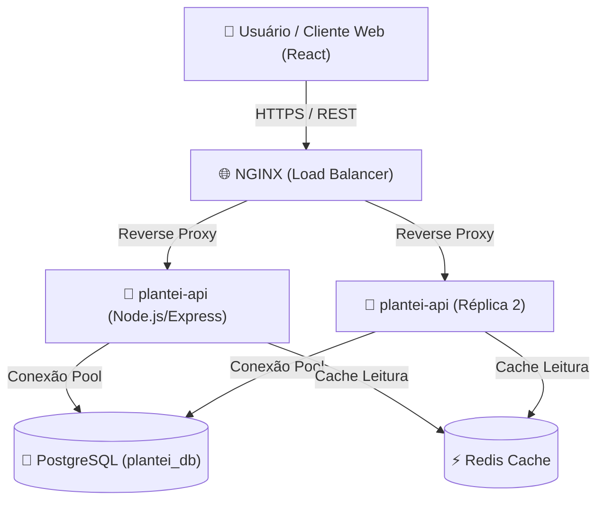

# Módulo 4 — System Design e Arquitetura Escalável com IA
# Disciplina 2 — Acelerando a Documentação com IA: OpenAPI/Swagger, Diagramas C4 e ADRs Vivos
**Duração estimada:** 9–10 min  
**Projeto:** `plantei-api`  
**Arquivos de referência:** `src/app.js` · `src/routes/produto.routes.js` · `docs/swagger.js` · `docs/diagrams/c4-model.mmd`  
**Objetivo:** Integrar documentação interativa Swagger (OpenAPI 3.0) ao `plantei-api`, utilizar Inteligência Artificial para extrair schemas e anotações a partir do código, e gerar documentação arquitetural viva (C4 Model com Mermaid e Architecture Decision Records - ADRs) em até 10 minutos.

---

## 🎬 ABERTURA (0:00 – 1:00)

**[TELA: Editor aberto com código e uma aba de navegador com interface interativa do Swagger UI do `plantei-api`]**

> "Fala devs, sejam muito bem-vindos à **Disciplina 2: Acelerando a Documentação com IA**!"

> "Vamos ser honestos: quase todo desenvolvedor adora código, mas odeia escrever e manter documentação. O resultado todo mundo conhece: documentos em Word ou Notion que ficam desatualizados logo no primeiro commit e acabam sendo abandonados."

> "Só que um sistema sem documentação clara é um sistema que não escala: o onboarding de novos desenvolvedores demora meses e a integração com times de frontend ou parceiros externos vira um caos de perguntas no chat da empresa."

> "A boa notícia é que você **não precisa mais escrever documentação manualmente do zero**. Hoje vamos aprender como usar Inteligência Artificial para gerar especificações OpenAPI/Swagger perfeitas a partir do código do `plantei-api`, criar diagramas de arquitetura C4 Model e registrar decisões com ADRs em menos de 10 minutos."

---

## 📖 PARTE 1 — O Padrão OpenAPI 3.0 e Swagger no Express (1:00 – 3:00)

**[TELA: Navegador exibindo `http://localhost:3000/api-docs` com a interface Swagger UI interativa]**

> "O padrão da indústria para documentar APIs RESTful é a especificação **OpenAPI 3.0** (anteriormente conhecida como Swagger). Ela define esquemas de requisição, parâmetros, respostas e autenticação em um formato padronizado (JSON ou YAML)."

> "No `plantei-api`, integramos o `swagger-ui-express` diretamente no nosso `src/app.js`:"

```javascript
// src/app.js ou docs/swagger.js
import swaggerUi from 'swagger-ui-express';
import swaggerDocument from './swagger.json' assert { type: 'json' };

// Rota para documentação interativa
app.use('/api-docs', swaggerUi.serve, swaggerUi.setup(swaggerDocument));
```

> "Ao acessar `/api-docs`, qualquer pessoa — seja um desenvolvedor front-end, um testador de QA ou um cliente — consegue testar as rotas interativamente, disparar requisições autenticadas e ver os esquemas de retorno em tempo real."

---

## 🤖 PARTE 2 — Usando IA para Gerar Schemas e Anotações (3:00 – 5:15)

**[TELA: Dividir a tela: lado esquerdo `src/models/Produto.js` e `src/controllers/produto.controller.js`; lado direito prompt da IA gerando a especificação OpenAPI]**

> "Escrever o arquivo OpenAPI na mão linha por linha é tedioso e sujeito a erros. É aqui que a Inteligência Artificial entra como uma aceleradora impressionante."

> "Nós passamos o model Sequelize e o controller correspondente para a IA com o seguinte prompt contextual:"

```markdown
Prompt de Engenharia de Documentação:
"Você é um Arquiteto de Software especialista em OpenAPI 3.0.
Com base no Model Produto e no Controller em anexo (rotas GET, POST, PUT, DELETE):
1. Gere a especificação completa de paths e schemas em formato JSON/YAML.
2. Defina os campos obrigatórios, tipos (string, number, boolean) e exemplos reais.
3. Inclua respostas de sucesso (200, 201) e erros (400, 401, 404, 500).
4. Configure o esquema de segurança com Bearer JWT (HTTP Bearer)."
```

**[TELA: Mostrar a especificação OpenAPI gerada com perfeição]**

> "Em 5 segundos, a IA nos entrega o schema completo:"

```json
"/api/produtos": {
  "post": {
    "summary": "Cadastrar um novo produto",
    "tags": ["Produtos"],
    "security": [{ "bearerAuth": [] }],
    "requestBody": {
      "required": true,
      "content": {
        "application/json": {
          "schema": {
            "type": "object",
            "required": ["nome", "preco", "categoria"],
            "properties": {
              "nome": { "type": "string", "example": "Monstera Deliciosa (Costela-de-Adão)" },
              "preco": { "type": "number", "example": 89.90 },
              "categoria": { "type": "string", "example": "Plantas de Interior" },
              "estoque": { "type": "integer", "example": 25 }
            }
          }
        }
      }
    },
    "responses": {
      "201": { "description": "Produto cadastrado com sucesso" },
      "400": { "description": "Dados inválidos fornecidos" }
    }
  }
}
```

> "Colamos no projeto e nossa documentação viva está completa, sem esforço mecânico!"

---

## 📐 PARTE 3 — Documentação Arquitetural com C4 Model e Mermaid (5:15 – 7:15)

**[TELA: Renderizar diagrama Mermaid no VS Code ou navegador com os níveis Context e Container do C4 Model]**

> "Documentação de API é essencial, mas ela mostra apenas as árvores. Para enxergar a floresta inteira, nós precisamos de documentação arquitetural. O padrão moderno mais respeitado é o **C4 Model** (Context, Containers, Components, Code)."

> "Com a IA, podemos gerar o código do diagrama no padrão **Mermaid**, que é renderizado nativamente no GitHub e em qualquer documentação Markdown:"



> "Esse diagrama vive no próprio repositório Git dentro da pasta `docs/diagrams/`. Quando a arquitetura evolui, nós alteramos o código Mermaid e o diagrama se atualiza automaticamente em todos os Pull Requests."

---

## 📝 PARTE 4 — Registros de Decisão de Arquitetura (ADRs) com IA (7:15 – 8:50)

**[TELA: Abrir arquivo `docs/adr/001-adopcao-postgresql-e-jwt.md`]**

> "Quantas vezes você entrou em um projeto antigo e se perguntou: *'Por que escolheram essa biblioteca? Por que o banco é relacional e não NoSQL?'* E ninguém sabia responder porque o desenvolvedor que decidiu já tinha saído da empresa."

> "Para resolver isso, utilizamos os **ADRs (Architecture Decision Records)**. É um documento curto e estruturado que registra decisões arquiteturais críticas:"

```markdown
# ADR 001: Adoção de PostgreSQL e Autenticação JWT no Plantei API
## Status: Aceito (Accepted)
## Contexto:
A plataforma Plantei necessita de controle transacional rigoroso para estoque 
e relações N:N entre perfis e permissões de usuários.
## Decisão:
Adotar o banco relacional PostgreSQL com ORM Sequelize e autenticação via JWT 
stateless para permitir balanceamento de carga horizontal.
## Consequências:
- Positivo: Integridade referencial garantida pelo SGBD e facilidade de escala das réplicas.
- Negativo: Necessidade de migrações estruturadas para alterações de schema.
```

> "Usamos a IA para rascunhar o ADR sempre que uma decisão importante for tomada no projeto, garantindo memória técnica perene para o time."

---

## 🎯 CONCLUSÃO E PRÓXIMOS PASSOS (8:50 – 10:00)

**[TELA: Professor em destaque com resumo dos tópicos abordados]**

> "Hoje provamos que documentação não precisa ser um fardo. Com a estratégia certa e o uso de IA como copiloto, você gera Swagger/OpenAPI interativo, diagramas arquiteturais C4 Model e ADRs em questão de minutos."

> "Agora que nosso sistema está modelado, documentado e compreensível para qualquer engenheiro, resta um grande desafio: **como fazer esse sistema responder em milissegundos mesmo sob milhares de requisições por segundo?**"

> "Na nossa **Disciplina 3: Otimização e Performance**, vamos caçar gargalos de banco de dados, implementar cache com Redis e rodar testes de carga com k6."

> "Até lá!"

---

## 📋 CHECKLIST RÁPIDO DO GRAVADOR

- [ ] **0:00** Abrir destacando por que a documentação morre quando feita de forma manual.
- [ ] **1:00** Mostrar a rota `/api-docs` do Swagger UI funcionando no navegador.
- [ ] **3:00** Exibir o prompt de IA lendo `Produto.js` e gerando o JSON OpenAPI 3.0.
- [ ] **5:15** Exibir o diagrama C4 Model renderizado em Mermaid com cliente, API, Postgres e Redis.
- [ ] **7:15** Apresentar a estrutura de um Architecture Decision Record (ADR 001).
- [ ] **8:50** Concluir e fazer o gancho para a Disciplina 3 (Otimização e Performance).
