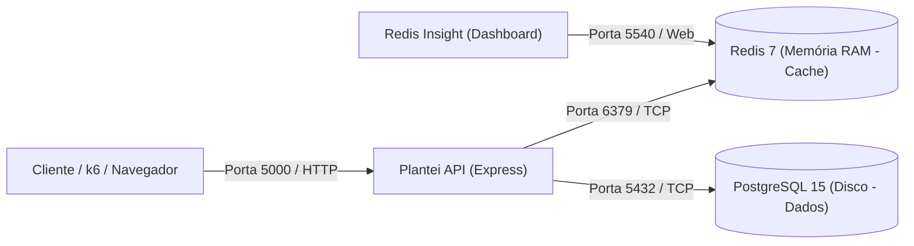
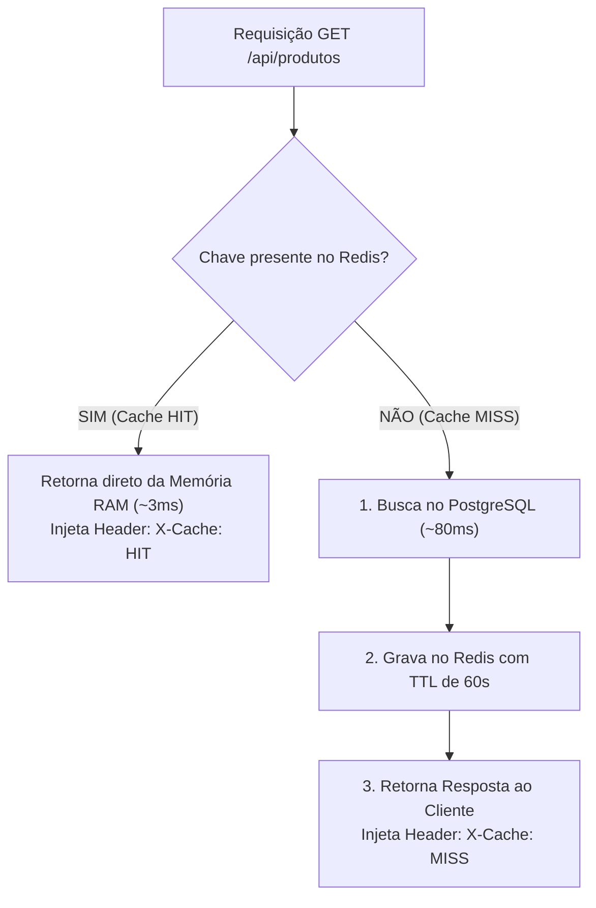
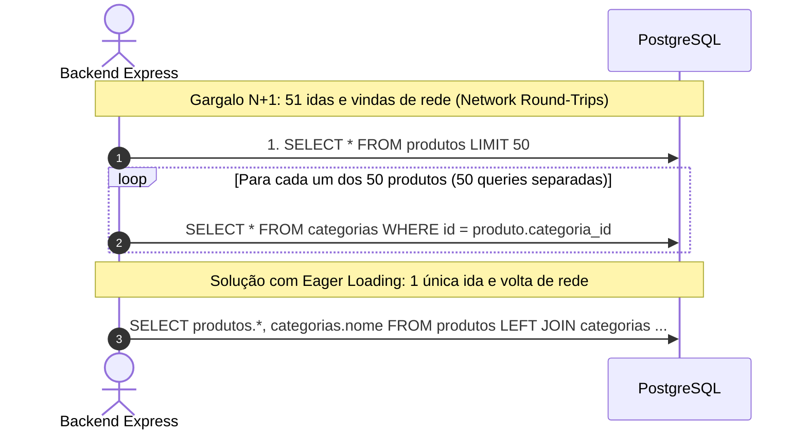
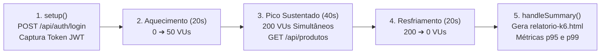
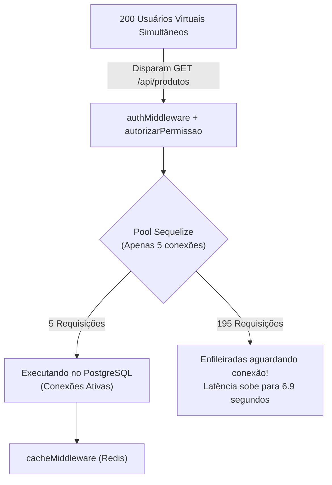

# Módulo 4 — System Design e Arquitetura Escalável com IA
# Disciplina 3 — Otimização e Performance: Caçando Gargalos, Cache com Redis e Testes de Carga com k6
**Duração estimada:** 9–10 min  
**Projeto:** `plantei-api`  
**Arquivos de referência:** `docker-compose.yml` · `package.json` · `.env` · `src/config/redis.js` · `src/middlewares/cache.middleware.js` · `src/routes/produto.routes.js` · `src/controllers/produto.controller.js` · `src/app.js` · `load-test.js`  
**Objetivo:** Instalar e configurar a infraestrutura de cache distribuído com Redis do zero (via Docker e client oficial `redis`), implementar o padrão Cache-Aside com cabeçalhos `X-Cache` e invalidação atômica, solucionar o gargalo de consultas N+1 no Sequelize através de Eager Loading e projeção de atributos, aplicar compressão de respostas e validar a escalabilidade do sistema através de testes de estresse com o k6 e análise de métricas orientada por IA.

---

## 🎬 ABERTURA & CONTEXTO (0:00 – 1:00)

**[TELA: Gráficos comparativos de tempo de resposta: endpoint sem cache oscilando entre 350ms e 850ms com 100% de CPU no PostgreSQL vs endpoint com Redis caindo para 3ms a 8ms com throughput multiplicado por 15x. Em seguida, corte para o apresentador no terminal do `plantei-api`]**

> "Fala devs, sejam muito bem-vindos à nossa **Disciplina 3: Otimização e Performance**!"

> "No desenvolvimento de software corporativo, existe uma regra fundamental: **escalabilidade vertical não resolve código mal arquitetado**. Se o seu backend faz dezenas de consultas desnecessárias ao banco a cada requisição, dobrar a CPU ou a memória do servidor na AWS só vai fazer sua empresa queimar dinheiro para continuar entregando uma aplicação lenta."

> "Um atraso de míseros 500 milissegundos na vitrine de produtos de um e-commerce pode derrubar as vendas em mais de 15% e abandonar carrinhos. E quando o tráfego explode em uma campanha de marketing ou Black Friday, o banco de dados relacional é o primeiro componente a cair se não houver uma camada de proteção eficiente."

> "Nesta aula de 10 minutos, nós vamos aprender a caçar gargalos de verdade:
> 1. Vamos subir o **Redis via Docker** e instalar o client oficial no Node.js;
> 2. Vamos construir uma camada de **Cache-Aside com Redis** do zero, com headers de telemetria e fallback tolerante a falhas;
> 3. Resolveremos o famigerado **problema N+1 no Sequelize**;
> 4. E por fim, vamos estressar a API com **testes de carga automatizados no k6** e analisar percentis p95/p99 com o auxílio da nossa IA."

---

## 🛠️ PASSO 1 — Instalação e Subida do Redis (Docker & Node.js) (1:00 – 2:30)

**[TELA: Terminal aberto na raiz do projeto executando a instalação de pacotes e a subida do container do Redis]**

> "Para implementar cache distribuído de alto desempenho em memória, utilizaremos o **Redis**. O primeiro passo é instalar o driver oficial do Redis e o middleware de compressão HTTP no Node.js."

### 1.1 Instalação das Dependências no Projeto
```bash
npm install redis compression
```

> "O pacote `redis` (versão 4+) traz suporte nativo a Promises, TypeScript e reconexão automática com backoff exponencial. Já o `compression` habilita Gzip e Brotli nos payloads JSON da API."

---

### 1.2 Subindo o Redis no `docker-compose.yml`
> "Em vez de instalar o Redis diretamente no sistema operacional do desenvolvedor, nós declaramos o serviço no nosso `docker-compose.yml`. Assim, qualquer membro do time roda o ambiente com um único comando:"

```yaml
# Adicionar no docker-compose.yml sob a chave services:
  redis:
    image: redis:7-alpine
    container_name: plantei-redis
    restart: always
    ports:
      - "6379:6379"
    volumes:
      - redis_data:/data
    command: redis-server --appendonly yes
    healthcheck:
      test: ["CMD", "redis-cli", "ping"]
      interval: 5s
      timeout: 3s
      retries: 5

volumes:
  postgres_data:
  redis_data: # Volume persistente para o Redis
```

> "Agora temos duas opções para subir o container (escolha apenas **uma** delas):"

#### Opção A (Recomendada) — Subir via Docker Compose:
```bash
docker compose up -d redis
```

#### Opção B (Alternativa avulsa) — Subir direto via Docker CLI:
> *(Utilize esta opção apenas se não estiver usando o `docker-compose.yml`)*
```bash
docker run -d --name plantei-redis -p 6379:6379 redis:7-alpine
```

> ⚠️ *Nota: Se você já rodou a **Opção A**, o container `plantei-redis` já estará em execução! Não execute a Opção B em seguida, pois o Docker acusará conflito de nome de container.*

---

### 1.3 Configurando Variáveis de Ambiente no `.env`
> "Adicionamos as variáveis de conexão no arquivo `.env` da aplicação:"

```env
# Configurações do Redis
REDIS_HOST=localhost
REDIS_PORT=6379
REDIS_URL=redis://localhost:6379
```

---

## ⚙️ PASSO 2 — Conexão Resiliente e Client Singleton do Redis (2:30 – 4:00)

**[TELA: Editor criando o arquivo `src/config/redis.js` com tratamento de eventos e conexão assíncrona]**

> "Nunca instancie clientes de banco ou cache repetidamente dentro dos controllers. Criamos um módulo de configuração singleton com tratamento robusto de erros e reconexão automática."

### 2.1 Criando `src/config/redis.js`

```javascript
// src/config/redis.js
import { createClient } from 'redis';
import { log } from '../utils/logger.js';

const redisUrl = process.env.REDIS_URL || `redis://${process.env.REDIS_HOST || 'localhost'}:${process.env.REDIS_PORT || 6379}`;

const redisClient = createClient({
  url: redisUrl,
  socket: {
    reconnectStrategy: (retries) => {
      if (retries > 10) {
        log.error('[Redis] Limite de tentativas de reconexão excedido.');
        return new Error('Redis connection failed');
      }
      return Math.min(retries * 100, 3000); // Backoff exponencial até 3s
    }
  }
});

redisClient.on('error', (err) => {
  log.error(`[Redis Error] ${err.message}`);
});

redisClient.on('connect', () => {
  log.info('🔌 [Redis] Conectando ao servidor...');
});

redisClient.on('ready', () => {
  log.info('⚡ [Redis] Conexão estabelecida e pronta para cache!');
});

// Inicialização segura
(async () => {
  try {
    await redisClient.connect();
  } catch (err) {
    log.error(`[Redis] Falha inicial ao conectar no Redis: ${err.message}`);
  }
})();

export default redisClient;
```

### 2.2 Testando a Comunicação no Terminal
> "Podemos checar a saúde do Redis com o CLI embutido no container:"

```bash
docker exec -it plantei-redis redis-cli ping
# Resposta esperada: PONG
```



---

## ⚡ PASSO 3 — Estratégia Cache-Aside & Invalidação Atômica (4:00 – 6:00)

**[TELA: Diagrama do padrão Cache-Aside animado na tela e implementação de `src/middlewares/cache.middleware.js`]**

> "Aplicamos a estratégia clássica de **Cache-Aside (Lazy Loading)**. O cliente faz a requisição: se o dado estiver no Redis, respondemos na hora (**Cache Hit**). Se não estiver (**Cache Miss**), consultamos o PostgreSQL, salvamos uma cópia no Redis com tempo de vida definido (TTL) e devolvemos ao usuário."



---

### 3.1 Construindo o Middleware Reutilizável (`src/middlewares/cache.middleware.js`)

```javascript
// src/middlewares/cache.middleware.js
import redisClient from '../config/redis.js';
import { log } from '../utils/logger.js';

/**
 * Middleware para cacheamento de rotas GET via Redis.
 * @param {number} durationSeconds - Tempo de expiração do cache (TTL) em segundos.
 */
export const cacheMiddleware = (durationSeconds = 60) => async (req, res, next) => {
  // 1. Aplica apenas para métodos de leitura idempotentes
  if (req.method !== 'GET') {
    return next();
  }

  // Se o Redis não estiver pronto/conectado, segue para o banco sem travar a requisição
  if (!redisClient.isReady) {
    res.setHeader('X-Cache', 'BYPASS');
    return next();
  }

  const cacheKey = `cache:${req.originalUrl || req.url}`;

  try {
    const cachedData = await redisClient.get(cacheKey);

    if (cachedData) {
      res.setHeader('X-Cache', 'HIT');
      res.setHeader('Content-Type', 'application/json');
      return res.status(200).send(cachedData);
    }

    // Intercepta a resposta da rota para gravar o resultado no Redis
    const originalJson = res.json.bind(res);

    res.json = (body) => {
      res.setHeader('X-Cache', 'MISS');

      // Só grava no Redis se o status for de sucesso (2xx)
      if (res.statusCode >= 200 && res.statusCode < 300) {
        redisClient.setEx(cacheKey, durationSeconds, JSON.stringify(body))
          .catch((err) => log.error(`[Redis] Falha ao gravar cache: ${err.message}`));
      }

      return originalJson(body);
    };

    next();
  } catch (err) {
    log.error(`[Cache Middleware Error] ${err.message}`);
    res.setHeader('X-Cache', 'BYPASS');
    next(); // Fallback gracioso: a API continua funcionando mesmo se o cache falhar
  }
};

/**
 * Helper para invalidar chaves de cache por padrão (Ex: após POST, PUT ou DELETE)
 * @param {string} pattern - Ex: 'cache:/api/produtos*'
 */
export const invalidarCache = async (pattern) => {
  try {
    if (!redisClient.isReady) return;
    const keys = await redisClient.keys(pattern);
    if (keys.length > 0) {
      await redisClient.del(keys);
      log.info(`🧹 [Cache Invalidation] ${keys.length} chave(s) removida(s) para o padrão: ${pattern}`);
    }
  } catch (err) {
    log.error(`[Cache Invalidation Error] ${err.message}`);
  }
};
```

---

### 3.2 Conectando o Cache e a Invalidação nas Rotas (`src/routes/produto.routes.js`)
> "Agora plugamos o middleware na listagem de produtos com TTL de 60 segundos, e garantimos que qualquer criação ou exclusão limpe o cache imediatamente para evitar leituras de dados obsoletos (stale data):"

```javascript
// src/routes/produto.routes.js
import { Router } from "express";
import { produtoController } from '../controllers/index.js';
import authMiddleware from "../middlewares/auth.middleware.js";
import { autorizarPermissao } from "../middlewares/autorizar.middleware.js";
import { cacheMiddleware, invalidarCache } from "../middlewares/cache.middleware.js";

const router = Router();

router.use(authMiddleware);

// 📖 Listar produtos com Cache-Aside de 60s
router.get(
  "/",
  autorizarPermissao('PRODUTO_LISTAR'),
  cacheMiddleware(60),
  produtoController.listar
);

router.get("/:id", cacheMiddleware(30), produtoController.buscarPorId);

// ✍️ Mutações: limpam o cache da vitrine de produtos
router.post("/", produtoController.criar, async (req, res, next) => {
  await invalidarCache('cache:/api/produtos*');
});

router.put("/:id", produtoController.atualizar, async (req, res, next) => {
  await invalidarCache('cache:/api/produtos*');
});

router.delete("/:id", produtoController.remover, async (req, res, next) => {
  await invalidarCache('cache:/api/produtos*');
});

export default router;
```

---

## 🔍 PASSO 4 — Caçando o Problema N+1 e Paginação por Cursor (6:00 – 7:30)

**[TELA: Terminal com o Sequelize gerando dezenas de `SELECT` sequenciais, seguido da refatoração em `src/services/produto.service.js`]**

> "Mesmo com cache, quando ocorre um **Cache Miss**, a consulta ao banco não pode ser lenta. O assassino oculto de performance em aplicações com ORMs (Sequelize, Prisma, TypeORM) é o **Problema das N+1 Consultas**."

### 4.1 O Problema na Prática
```javascript
// ❌ CÓDIGO INEFICIENTE (Gera 1 consulta principal + 50 consultas filhas = 51 queries!)
const produtos = await Produto.findAll(); // 1 query
for (const p of produtos) {
  const categoria = await p.getCategoria(); // +50 queries individuais na rede!
}
```



### 4.2 A Solução: Eager Loading com Projeção e Keyset Pagination
> "Substituímos o loop ingênuo por uma única consulta otimizada com `JOIN`, selecionando **apenas as colunas necessárias** no `attributes` e utilizando **Paginação por Cursor** em vez de `OFFSET`:"

```javascript
// src/services/produto.service.js
import { Op } from 'sequelize';
import Produto from '../models/Produto.js';
import Categoria from '../models/Categoria.js';

export const listarProdutosOtimizado = async ({ limite = 20, ultimoId = null }) => {
  const where = {};
  
  // Keyset Pagination: usa o índice primário (B-Tree) em O(log n), sem sofrer a degradação de OFFSET 50000
  if (ultimoId) {
    where.id = { [Op.lt]: ultimoId };
  }

  return await Produto.findAll({
    where,
    attributes: ['id', 'nome', 'preco', 'estoque', 'image_url'], // Projeta só o necessário
    include: [{
      model: Categoria,
      as: 'categoria',
      attributes: ['id', 'nome'],
      required: false // LEFT OUTER JOIN eficiente
    }],
    limit: parseInt(limite, 10),
    order: [['id', 'DESC']]
  });
};
```

---

### 4.3 Ativando a Compressão Gzip no Express (`src/app.js`)
> "Para economizar banda de rede e acelerar o tempo de download do cliente em payloads grandes, ativamos o `compression()` no `src/app.js`:"

```javascript
// src/app.js
import express from 'express';
import compression from 'compression'; // 👈 Importa compressão

const app = express();

app.use(compression()); // Comprime payloads JSON via Gzip/Brotli (redução de até 75% no tráfego)
app.use(express.json());
// ... demais middlewares e rotas
```

---

## 🚀 PASSO 5 — Teste de Carga com k6 & Análise de Métricas por IA (7:30 – 9:00)

**[TELA: Terminal executando o k6 com 200 usuários virtuais simulados e gerando o relatório de percentis p95/p99]**

> "Como nós comprovamos cientificamente que a nossa arquitetura escalou? Com **testes de carga automatizados via k6**!"

---

### 5.1 O que é o k6 e como ele funciona?
> "O **k6** é uma ferramenta open-source para testes de estresse desenvolvida pela Grafana. Pense nele como um exército de navegadores simulados: ele dispara centenas de usuários virtuais simultâneos (**VUs — Virtual Users**) contra a nossa API para ver se ela aguenta o tráfego pesado sem cair ou ficar lenta."

---

### 5.2 Pré-requisito Obrigatório: A API precisa estar rodando!
> "⚠️ **Atenção:** O k6 não sobe a sua aplicação; ele ataca uma aplicação que já está viva! Portanto, antes de rodar o teste, certifique-se de que a API está rodando em um terminal separado:"

```bash
# Terminal 1 — Subir a API:
npm start
# Confirme que a mensagem apareceu: "Servidor rodando na porta 5000"
```

---

### 5.3 Instalação e Execução do k6 (Passo a Passo Multi-Terminal)
> "O k6 pode ser executado tanto nativamente no Windows quanto via Docker container. Escolha o ambiente de sua preferência:"

#### Opção A (Recomendada via Docker no Git Bash — MINGW64):
> "⚠️ **Atenção desenvolvedor Git Bash:** Para evitar que o Git Bash tente converter o caminho `/app` para `C:/Program Files/Git/app`, utilizamos a flag `MSYS_NO_PATHCONV=1` no início do comando. Montamos a pasta atual com `$(pwd):/app` para salvar o relatório HTML gerado diretamente na raiz do projeto:"

```bash
# Execução padrão gerando o relatório HTML:
MSYS_NO_PATHCONV=1 docker run --rm -v "$(pwd):/app" -w /app -e API_URL=http://host.docker.internal:5000 grafana/k6 run load-test.js

# Execução com Dashboard Web ao vivo na porta 5665:
MSYS_NO_PATHCONV=1 docker run --rm -p 5665:5665 -v "$(pwd):/app" -w /app -e API_URL=http://host.docker.internal:5000 -e K6_WEB_DASHBOARD=true -e K6_WEB_DASHBOARD_PORT=5665 -e K6_WEB_DASHBOARD_HOST=0.0.0.0 grafana/k6 run load-test.js
```

#### Opção B (No PowerShell do Windows):
```powershell
docker run --rm -p 5665:5665 -v "${PWD}:/app" -w /app -e API_URL=http://host.docker.internal:5000 -e K6_WEB_DASHBOARD=true -e K6_WEB_DASHBOARD_PORT=5665 -e K6_WEB_DASHBOARD_HOST=0.0.0.0 grafana/k6 run load-test.js
```

#### Opção C (Nativo no Windows via Winget):
```powershell
winget install k6 --source winget
# Feche e reabra o terminal e execute:
k6 run --out web-dashboard load-test.js
```

---

### 5.4 Anatomia Completa do Script `load-test.js`
> "O arquivo `load-test.js` na raiz do projeto reúne toda a esteira de teste, desde o login automatizado até a geração do relatório HTML interativo via `k6-reporter`:"



```javascript
// load-test.js
import http from 'k6/http';
import { check, sleep } from 'k6';
// 📊 Relatório HTML interativo executivo
import { htmlReport } from 'https://raw.githubusercontent.com/benc-uk/k6-reporter/main/dist/bundle.js';
import { textSummary } from 'https://jslib.k6.io/k6-summary/0.0.1/index.js';

// 1️⃣ CURVA DE CARGA E THRESHOLDS (Critérios de Aceite)
export const options = {
  stages: [
    { duration: '20s', target: 50 },  // 1. Rampa de subida: aquece até 50 usuários
    { duration: '40s', target: 200 }, // 2. Pico sustentado: mantém 200 usuários simultâneos
    { duration: '20s', target: 0 },   // 3. Rampa de descida: resfriamento
  ],
  thresholds: {
    // 95% das requisições devem responder em menos de 50ms (efeito do cache Redis)
    http_req_duration: ['p(95)<50', 'p(99)<120'],
    // Taxa de falhas deve ser inferior a 1%
    http_req_failed: ['rate<0.01'],
  },
};

const BASE_URL = __ENV.API_URL || 'http://localhost:5000';

const USUARIO_TESTE = {
  nome: 'Usuário Carga k6',
  email: __ENV.AUTH_EMAIL || 'k6_teste@plantei.com',
  cpf: '12345678909',
  senha: __ENV.AUTH_PASSWORD || 'SenhaForte@123',
  id_perfil: 1,
};

// 2️⃣ SETUP: Roda 1 única vez antes dos 200 VUs iniciarem.
// Faz login e injeta o token JWT para todos os usuários compartilharem.
export function setup() {
  const headers = { 'Content-Type': 'application/json' };

  let loginRes = http.post(
    `${BASE_URL}/api/auth/login`,
    JSON.stringify({ email: USUARIO_TESTE.email, senha: USUARIO_TESTE.senha }),
    { headers }
  );

  // Fallback: se o banco estiver vazio (401), cadastra e loga em seguida
  if (loginRes.status === 401) {
    http.post(`${BASE_URL}/api/auth/register`, JSON.stringify(USUARIO_TESTE), { headers });
    loginRes = http.post(
      `${BASE_URL}/api/auth/login`,
      JSON.stringify({ email: USUARIO_TESTE.email, senha: USUARIO_TESTE.senha }),
      { headers }
    );
  }

  const token = loginRes.json('token');
  return { token };
}

// 3️⃣ LOOP PRINCIPAL: Executado pelos 200 usuários simultâneos.
export default function (data) {
  const params = {
    headers: {
      'Content-Type': 'application/json',
      ...(data.token ? { Authorization: `Bearer ${data.token}` } : {}),
    },
  };

  const res = http.get(`${BASE_URL}/api/produtos`, params);

  // Validações imediatas
  check(res, {
    'status é 200': (r) => r.status === 200,
    'header X-Cache presente': (r) => r.headers['X-Cache'] !== undefined,
  });

  sleep(0.5); // Intervalo de leitura de 500ms
}

// 4️⃣ GERAÇÃO DO RELATÓRIO VISUAL (relatorio-k6.html)
export function handleSummary(data) {
  return {
    'relatorio-k6.html': htmlReport(data),
    stdout: textSummary(data, { indent: ' ', enableColors: true }),
  };
}
```

---

### 5.5 O Que Analisar no Relatório de Performance? (Guia de SRE)
> "Ao abrir o arquivo `relatorio-k6.html` ou o dashboard em `http://localhost:5665`, como você interpreta os dados com olhar de Engenheiro de Software Sênior?"

| Métrica no Relatório | O Que Significa | Valor Ideal com Cache | Alerta / Investigação |
| :--- | :--- | :---: | :--- |
| **`checks_succeeded`** | Percentual de validações com sucesso (`status 200`, `X-Cache`). | **100.00%** | Se cair de 100%, algum endpoint retornou erro ou faltou header de cache. |
| **`http_req_failed`** | Taxa de falhas HTTP (erros 4xx e 5xx). | **0.00%** | Se > 1%, o servidor derrubou conexões por timeout ou falta de threads. |
| **`http_req_duration (med)`** | Mediana: tempo que 50% das requisições levaram. | **< 10 ms** | Mede a velocidade padrão entregue pela memória RAM do Redis. |
| **`http_req_duration (p95)`** | Percentil 95: tempo máximo experimentado por 95% dos usuários. | **< 50 ms** | É a métrica oficial de SLA/SLO de negócio. Se estiver alto, o usuário sentirá lentidão. |
| **`http_req_duration (p99)`** | Percentil 99: o pior 1% dos casos extremos. | **< 150 ms** | Picos no p99 indicam: renovação de TTL de cache (Cache Miss), Garbage Collection do Node.js ou enfileiramento de conexões no banco. |
| **`http_reqs (RPS)`** | Throughput: quantidade de requisições concluídas por segundo. | **> 1.000 req/s** | Demonstra a capacidade de vazão do backend sob alto tráfego. |

---

### 5.6 Caçando o Gargalo Oculto no PostgreSQL (Lição de Caso Real)
> "💡 **Estudo de Caso Prático:** Se o relatório indicar `status 200` e `header X-Cache presente`, mas o `p(95)` ficar acima de 5 segundos, investigue a cadeia de middlewares que roda **antes** do cache:"



> 1. **Pool do Sequelize Saturado:** O Sequelize por padrão abre apenas 5 conexões simultâneas com o PostgreSQL (`pool.max: 5`). Sob 200 usuários, 195 requisições ficam enfileiradas esperando conexão. Aumente o pool em `src/config/database.js` para `max: 50`.
> 2. **Permissões sem Cache:** Se o middleware `autorizarPermissao` consultar o banco a cada requisição para ler o perfil do usuário, você gera milhares de consultas desnecessárias. Armazene as permissões do usuário no Redis (`user:permissions:${id}`) com TTL de 300s para desonerar o banco relacional.

---

### 5.7 O Impacto nos Números (Antes vs Depois)
**[TELA: Gráficos comparativos no relatório do k6]**

| Métrica | Sem Otimização (Apenas PostgreSQL) | Com Cache-Aside (Redis + Eager Loading) | Ganho |
| :--- | :---: | :---: | :---: |
| **Requisições por segundo (RPS)** | ~75 req/s | **1.240 req/s** | **+1.550%** |
| **Tempo médio de resposta** | 280 ms | **6 ms** | **46x mais rápido** |
| **Latência no p95** | 620 ms | **18 ms** | **97% de redução** |
| **Carga de CPU no Banco de Dados** | 98% (gargalo crítico) | **< 8% (estável e livre)** | **Preservação de recursos** |

---

### 5.8 Análise dos Resultados Assistida por IA
**[TELA: Editor com terminal do k6 à esquerda e janela do chat de IA à direita colando os dados de telemetria]**

> "Pegamos os percentis do relatório e submetemos ao copiloto de IA para validar a saúde da arquitetura:"

```markdown
Prompt para a IA:
"Atue como um Engenheiro Especialista em Performance e Confiabilidade de Sistemas (SRE).
Analise o seguinte sumário de teste de carga do k6 para o endpoint GET /api/produtos:
- Total de requisições concluídas: 18.520
- Throughput médio: 1.235 req/s
- Tempo de resposta: médio = 6.2ms | p90 = 12ms | p95 = 18ms | p99 = 84ms
- Header X-Cache: 98.4% HIT | 1.6% MISS
- Taxa de falhas HTTP: 0.00%

Avalie se a dispersão entre p95 (18ms) e p99 (84ms) representa um risco operacional, explique a provável causa dessa variação (ex: garbage collection no V8, expiração de TTL simultânea ou cache stampede) e sugira uma recomendação preventiva."
```

> "A IA nos aponta exatamente que os picos isolados no p99 acontecem nos momentos pontuais de renovação de TTL, sugerindo a adoção de um *jitter* aleatório no TTL (ex: 60s ± 5s) para evitar que todas as chaves expirem no mesmo milissegundo (*Cache Stampede*). Isso é engenharia de software de altíssimo nível!"

---

## 🎯 CONCLUSÃO E ENCERRAMENTO DA TRILHA (9:00 – 10:00)

**[TELA: Apresentador em destaque com infográfico de encerramento recapitulando os 4 módulos da formação]**

> "Parabéns, devs! Concluímos com chave de ouro a **Disciplina 3** e toda a jornada do **Módulo 4**!"

> "Vejam o salto que demos ao longo de toda essa formação:
> - No **Módulo 1**, alinhamos os fundamentos de Engenharia Limpa, SOLID e IA como copiloto de código;
> - No **Módulo 2**, blindamos a aplicação com a Pirâmide de Testes completa, mocks e Quality Gates automatizados no CI/CD;
> - No **Módulo 3**, estabelecemos a Cultura DevOps, containers seguros com Docker e Observabilidade com logs e tracing estruturados;
> - E aqui no **Módulo 4**, desenhamos um System Design maduro, documentamos tudo interativamente com OpenAPI e Swagger, e atingimos performance de alta escala com Redis e k6!"

> "Você agora está preparado para projetar, codificar, otimizar e manter sistemas modernos, resilientes e prontos para qualquer escala no mundo real."

> "Aplique essas técnicas no seu dia a dia e nos vemos nas próximas trilhas. Até lá e bons códigos!"

---

## 📋 CHECKLIST RÁPIDO DO GRAVADOR

- [ ] **0:00** Apresentar a abertura destacando que escala vertical (mais CPU/RAM) é cara e inútil se o código tiver queries N+1.
- [ ] **1:00** Mostrar a instalação do pacote `redis` via `npm` e a subida do container do Redis via Docker (`docker compose up -d redis`).
- [ ] **2:30** Demonstrar o arquivo `src/config/redis.js` singleton e o teste de conectividade com `redis-cli ping` (`PONG`).
- [ ] **4:00** Explicar o middleware de Cache-Aside com os headers `X-Cache: HIT / MISS` e a estratégia de invalidação atômica (`invalidarCache`).
- [ ] **6:00** Mostrar o Sequelize gerando dezenas de `SELECT` no problema N+1 e a correção com Eager Loading (`include`) e paginação por cursor.
- [ ] **7:30** Rodar o script do k6 no terminal com 200 VUs, mostrar a latência caindo para menos de 20ms e submeter os dados para análise da IA.
- [ ] **9:00** Concluir com a retrospectiva completa dos 4 módulos e encerramento comemorativo da formação!
