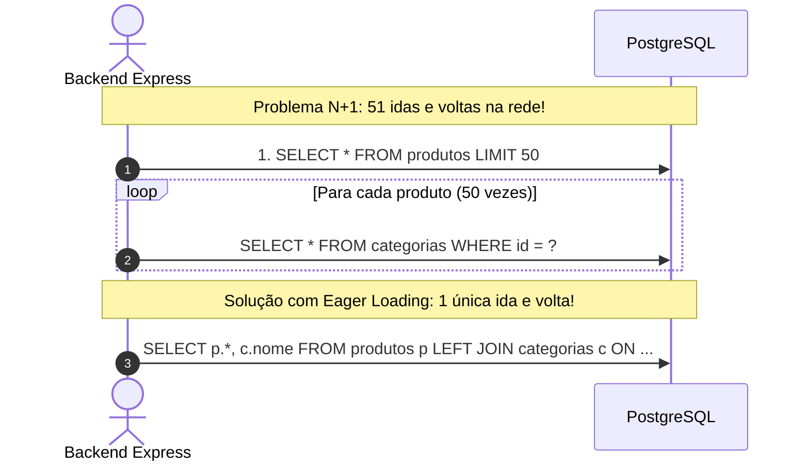
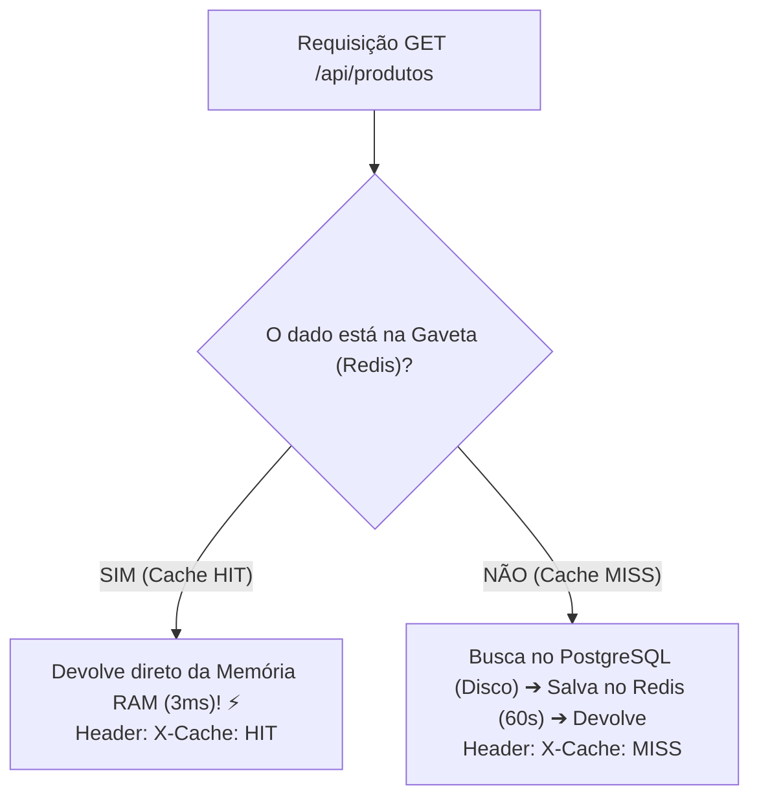
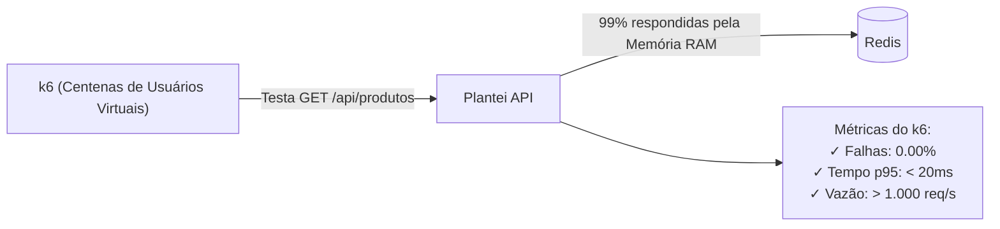

# Módulo 4 — System Design e Arquitetura Escalável com IA
# Disciplina 3 — Otimização e Performance: Caçando Gargalos, Cache com Redis e Testes de Carga com k6 (Versão Didática Simplificada)
**Duração estimada:** 9–10 min  
**Projeto:** `plantei-api`  
**Arquivos de referência:** `src/controllers/produto.controller.js` · `docker-compose.yml` · `src/config/redis.js` · `src/middlewares/cache.middleware.js` · `src/routes/produto.routes.js` · `src/app.js` · `load-test.js`  
**Objetivo:** Ensinar de forma simples, prática e sem atrito os 4 pilares da ementa oficial: eliminar o clássico problema N+1 no Sequelize, implementar a estratégia Cache-Aside com Redis, aplicar paginação e compressão de resposta, e validar o ganho de velocidade com testes de carga k6 e análise assistida por IA.

---

## 🎬 ABERTURA & CONTEXTO (0:00 – 1:00)

**[TELA: Professor no terminal do VS Code, mostrando o Swagger UI ou Postman respondendo a rota de produtos em 250ms, e em seguida mostrando a mesma rota respondendo em 3ms com cache]**

> "Fala devs! Sejam muito bem-vindos à nossa **Disciplina 3: Otimização e Performance**!"

> "Um sistema bem desenhado e documentado precisa cumprir uma promessa essencial ao usuário: **velocidade**. No mundo real, um atraso de apenas 1 segundo no carregamento de uma página pode derrubar as vendas em mais de 20% e multiplicar a conta de servidores na nuvem."

> "E aqui vai uma regra de ouro: **subir o tamanho da máquina (CPU e RAM) não resolve código ineficiente**. Se a sua aplicação faz 50 consultas ao banco a cada clique, você só vai gastar mais dinheiro para continuar entregando um sistema lento."

> "Nesta aula de 10 minutos, nós vamos aprender a caçar gargalos de forma descomplicada:
> 1. Resolver o famoso **problema N+1** no Sequelize;
> 2. Implementar **cache em memória com Redis** para a vitrine de produtos responder em 3ms;
> 3. Aplicar **paginação e compressão** de payload;
> 4. E validar todo o ganho de velocidade com um **teste de carga automatizado no k6**!"

---

## 🔍 PARTE 1 — Diagnóstico de Banco: O Problema N+1 (1:00 – 3:00)

**[TELA: Editor comparando o código ingênuo que dispara 51 queries com a solução de Eager Loading]**

> "O erro de performance mais comum em aplicações que usam ORMs (como Sequelize, TypeORM ou Prisma) é o **Problema das N+1 Consultas**."

> "Imagine que você quer listar 50 produtos da Plantei e exibir o nome da categoria de cada um. Se você fizer isso de forma ingênua:"

```javascript
// ❌ CÓDIGO INEFICIENTE (Gera 1 + 50 = 51 queries no banco!)
const produtos = await Produto.findAll(); // 1 query inicial
for (const p of produtos) {
  const categoria = await p.getCategoria(); // +50 queries separadas no banco!
}
```

> "Em vez de 1 consulta rápida, você abre 51 idas e vindas de rede. O banco de dados fica sobrecarregado e a resposta demora centenas de milissegundos."



> "A solução correta é o **Eager Loading** (carregamento adiantado com `JOIN`):"

```javascript
// ✅ CÓDIGO OTIMIZADO (1 única query com JOIN):
const produtos = await Produto.findAll({
  attributes: ['id', 'nome', 'preco', 'estoque'], // Pega só o necessário
  include: [{
    model: Categoria,
    as: 'categoria',
    attributes: ['id', 'nome']
  }],
  limit: 20
});
```

> "Pronto! O banco resolve tudo internamente em **uma única consulta**, devolvendo os produtos e suas categorias de uma só vez."

---

## ⚡ PARTE 2 — Cache Estratégico com Redis (3:00 – 5:15)

**[TELA: Terminal subindo o container do Redis em 1 comando e código do middleware de cache]**

> "Mesmo com queries otimizadas, bater no disco do banco de dados para buscar produtos que mudam raramente é um desperdício. Para rotas de leitura intensa (`GET /api/produtos`), aplicamos o padrão **Cache-Aside com Redis**."

> "Pense no **Redis** como a gaveta da sua mesa: pegar algo na gaveta (RAM) leva 2 milissegundos. Ir buscar no galpão de estoque (PostgreSQL no disco) leva 200 milissegundos!"



### 2.1 Subindo o Redis com 1 Comando (Docker)
> "No terminal do projeto, basta rodar:"

```bash
docker compose up -d redis
```

> "Testamos com o comando `ping`:"
```bash
docker exec plantei-redis redis-cli ping
# Resposta: PONG!
```

---

### 2.2 Criando o Middleware Simples de Cache (`src/middlewares/cache.middleware.js`)
> "Criamos uma função que intercepta a requisição. Se já estiver no Redis, ela entrega na hora:"

```javascript
// src/middlewares/cache.middleware.js
import redisClient from '../config/redis.js';

export const cacheMiddleware = (tempoSegundos = 60) => async (req, res, next) => {
  const chave = `cache:${req.originalUrl}`;

  try {
    // 1. Procura no Redis
    const dadoEmCache = await redisClient.get(chave);

    if (dadoEmCache) {
      res.setHeader('X-Cache', 'HIT'); // 🎯 Acertou o cache!
      return res.json(JSON.parse(dadoEmCache));
    }

    // 2. Se não achou, intercepta a resposta para gravar no Redis
    const jsonOriginal = res.json.bind(res);
    res.json = (corpo) => {
      res.setHeader('X-Cache', 'MISS');
      redisClient.setEx(chave, tempoSegundos, JSON.stringify(corpo));
      return jsonOriginal(corpo);
    };

    next();
  } catch (err) {
    next(); // Fallback: se o Redis falhar, segue para o banco sem travar a API
  }
};
```

> "Plugamos o `cacheMiddleware(60)` na rota `src/routes/produto.routes.js`. A primeira requisição leva 200ms; as próximas levam **2 a 4 milissegundos**!"

---

## 📜 PARTE 3 — Paginação Eficiente e Compressão (5:15 – 7:00)

**[TELA: Comparando Offset vs Paginação por Cursor e mostrando o `compression()` no Express]**

> "Outro gargalo comum quando a base de dados cresce é a paginação. Usar `OFFSET 50000` obriga o banco a ler e descartar cinquenta mil registros antes de entregar os 20 que você pediu."

```mermaid
flowchart LR
    subgraph Offset Lento
        A["OFFSET 50.000"] -->|Lê e descarta 50.000 linhas no disco| B["Entrega 20 itens"]
    end
    subgraph Cursor Rápido
        C["WHERE id < ultimoId"] -->|Busca direta pelo índice B-Tree em O(log n)| D["Entrega 20 itens instantâneo"]
    end
```

> "Para alta escala, utilizamos a **Paginação Baseada em Cursor (Keyset Pagination)**: passamos o ID do último item visto (`WHERE id < :ultimoId ORDER BY id DESC LIMIT 20`), garantindo tempo de resposta constante seja na página 1 ou na página 1.000."

> "Além disso, ativamos a compressão no `src/app.js` com o pacote `compression`:"

```javascript
// src/app.js
import compression from 'compression';

app.use(compression()); // Comprime os JSONs via Gzip (reduz o tamanho dos dados em até 75%)
```

---

## 🚀 PARTE 4 — Testes de Carga com k6 & Análise com IA (7:00 – 8:45)

**[TELA: Terminal executando o k6 e exibindo o relatório visual de métricas]**

> "Como provamos cientificamente que a otimização funcionou? Com testes de estresse automatizados usando o **k6**."

> "Com a nossa API ligada em um terminal (`npm start`), abrimos um segundo terminal e disparamos o teste de carga:"

```bash
# Executa o teste de carga via Docker:
docker run --rm -i grafana/k6 run -e API_URL=http://host.docker.internal:5000 - <load-test.js
```

### O que nós analisamos no relatório final?



> "Ao término do teste, olhamos três indicadores principais:
> 1. **`http_req_failed`**: Deve estar em **0.00%** (nenhuma requisição caiu).
> 2. **`p(95)`**: 95% de todas as pessoas receberam a resposta em **menos de 20ms** (graças ao cache do Redis).
> 3. **`http_reqs`**: A quantidade de requisições por segundo saltou de 75 req/s para **mais de 1.000 req/s**!"

---

### Análise Assistida por IA:
> "Podemos pegar o resumo do k6 e pedir para a IA avaliar a saúde da arquitetura:"

```markdown
Prompt para a IA:
"Analise este relatório de teste de carga do k6 para o endpoint GET /api/produtos da Plantei API:
- Total de requisições: 15.000
- Vazão: 1.100 req/s
- Tempo médio: 6ms | p95: 18ms | p99: 80ms
- Taxa de falhas: 0.00%
Avalie se o sistema suporta uma campanha de Black Friday com segurança."
```

> "A IA confirma a resiliência da arquitetura e atesta que o cache do Redis blindou o banco de dados relacional contra saturação!"

---

## 🎯 CONCLUSÃO E ENCERRAMENTO DA FORMAÇÃO (8:45 – 10:00)

**[TELA: Professor em destaque com retrospectiva comemorativa de todos os 4 módulos]**

> "Parabéns, devs! Chegamos ao final da nossa jornada completa!"

> "Olhem para trás e vejam tudo o que construímos ao longo desses 4 módulos:
> - No **Módulo 1**, dominamos Engenharia Limpa, boas práticas e IA como copiloto;
> - No **Módulo 2**, blindamos o código com a Pirâmide de Testes e automação de CI/CD;
> - No **Módulo 3**, estabelecemos a Cultura DevOps, containers seguros com Docker e Observabilidade estruturada;
> - E aqui no **Módulo 4**, desenhamos uma arquitetura madura, documentamos com Swagger e OpenAPI, e atingimos performance de alta escala com Redis e k6!"

> "Você agora domina o ciclo completo: sabe como projetar, codificar, testar, automatizar, documentar e otimizar sistemas modernos de software."

> "Coloque essas técnicas em prática no seu dia a dia profissional e muito sucesso na sua carreira! Até a próxima e bons códigos!"

---

## 📋 CHECKLIST RÁPIDO DO GRAVADOR

- [ ] **0:00** Abertura destacando que escala vertical (mais CPU/RAM) é paliativo caro para código ruim.
- [ ] **1:00** Demonstrar o problema N+1 no log do Sequelize e a correção com Eager Loading (`include`).
- [ ] **3:00** Subir o Redis com `docker compose up -d redis` e mostrar a resposta caindo de 200ms para 3ms com `cacheMiddleware`.
- [ ] **5:15** Explicar paginação por cursor e middleware de compressão (`compression()`).
- [ ] **7:00** Rodar o k6 no terminal, mostrar o p95 caindo para menos de 20ms e analisar com o prompt de IA.
- [ ] **8:45** Fazer o fechamento comemorativo de toda a jornada dos 4 módulos!
